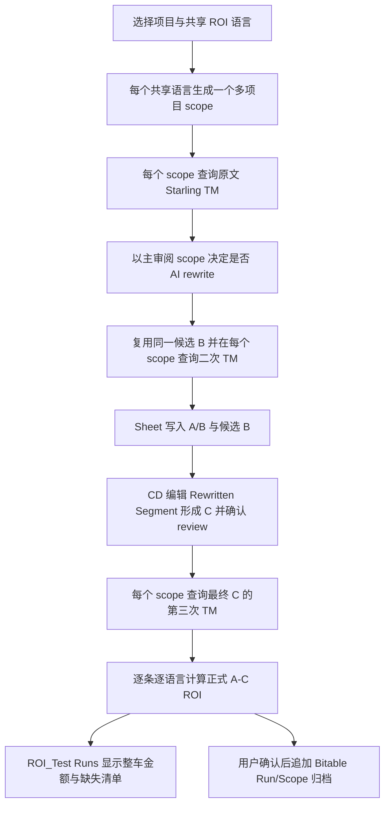

# 多语言整车 ROI

本文定义 L10n TM Companion 的多语言 ROI 业务逻辑、运行数据和失败语义。它是多语言成本计算的长期契约；`docs/popup-configuration.md` 定义 Popup 的通用配置交互，README 仅保留使用入口。

## 业务目标

用户提交一批英文 source 文案时，关注的是这批文案发布到全部需要翻译的目标语言后，经过 AI 辅助和 CD 最终确认，实际送翻版本相对原始版本能节省多少翻译费用。ROI 的计算范围是每个已选 Starling 项目及其被纳入本次 ROI 覆盖范围的目标语言，不能把单一语言的匹配率或价格外推到其他语言。

默认范围为全部已选项目共同支持的 `targetLocales`。用户在 Popup 选择一组共享语言，每个语言生成一个携带全部已选 `projectIds` 的 scope；最终金额覆盖 `selected shared target locales`。项目组合没有共同目标语言时，该组合不能启动 ROI 测算。

ROI mode 默认关闭。关闭时插件只运行一个快速 TM target scope，不加载费率、不构建多语言金额，也不允许确认 C 或写 archive；该运行产生 A/B 审阅结果，但不产生 ROI。用户显式开启 ROI mode 后，本文件定义的全部 scope、费率、C 验证与归档规则才生效。

## 核心定义

### 运行 scope

`locale scope` 是一个 `{ projectIds, sourceLocale, targetLocale }` 结构。它代表同一批 source 文案在全部已选 Starling 项目、一个目标语言中的独立 TM 和计费上下文。

一次运行至少有一个 locale scope。用户所选项目必须保持相同 source locale；每个共享 target locale 必须同时属于全部项目的 `targetLocales`，并只生成一个包含全部项目 ID 的 scope。用户显式取消的语言不会进入 scope，也不会进入金额或覆盖率分母。两个项目与二十一个共享语言必须显示并查询二十一个 scope。

### 真实 TM 快照

每个条目在每个 locale scope 均保存以下运行内快照：

- `original_tm`：原始英文 source，版本 A 的第一次真实 Starling TM 结果与 Score A。
- `post_rewrite_tm`：AI 产生非空 rewrite，版本 B 的第二次真实 Starling TM 结果与 Score B；它只用于帮助 CD 审阅。
- `final_tm`：CD 在 Spreadsheet 中确认的最终英文文案，版本 C 的第三次真实 Starling TM 结果与 Score C。
- `not_required`：本条未发生 rewrite，计费时改写后快照与 `original_tm` 相同。
- `incomplete`：接口、返回数量、score 或分类不满足契约，绝不伪造 0 分或成功快照。

Starling 的匹配率由 `sourceLocale + targetLocale + projectIds` 决定。所有目标语言都必须独立查询，禁止把某一语言的分数复制、乘数外推或作为其他语言的结果。

### 语言金额与整车金额

对每条文案、每个 locale scope，版本 A 与版本 C 分别使用各自真实 TM score、英文词数、vendor 的精确 `source_locale + target_locale` 费率及匹配分档计算 TM 成本：

`official AI saving = TM cost(A) - TM cost(C)`

版本 B 不参与正式金额计算。完整翻译基线仍可作为业务参考字段，但不能替代正式的 A−C ROI。整车金额是所有 complete locale line 的逐行 A−C 差额求和，仍属于本地英文计词的预估，不替代 Elasticsearch 结算字数或 vendor 最终账单。

AI 关闭或 CD 未确认时，没有可用的最终 C，正式 ROI 必须保持 `incomplete`；系统不得把 A、B 或完整翻译基线伪装为 C。

## 费率和失败语义

费率始终严格按 `vendor + source locale + target locale` 解析。系统禁止默认价格、跨 vendor 借价、语言回退、按比例派生 T-only 价格和以 0 填补缺失值。

单个 locale scope 在以下情况标为 `incomplete`：

- 缺少精确语言对或仅有 hourly rate。
- 首轮或最终 C TM 查询失败、返回异常或 score 非法。
- 当前 Sheet 布局的 `Rewritten Segment` 为空，或 `CD review valid?` 未被 CD 设为 `Yes`，因而没有最终 C。
- 原文无法得到有效可计费词数。

Starling 当前不返回 100% 命中的 ICE、重复或审核计费分类。为使整车预估可用，缺分类的 100% 命中按 T-only 的 20% 计算，这是已知分类中成本最高的保守值，并标记为 `exact_unclassified_conservative`。

任一已选 locale scope 不完整时，整车状态必须是 `incomplete`。ROI_Test 的 Run 仍需输出所有可计算文案的 A−C saving 小计、`complete scope count / selected scope count`、未覆盖 scope 清单和每项具体原因。一个 scope 内的局部失败不能再丢弃其他完整文案的金额；subtotal 必须标为“已覆盖文案小计”，不得显示为完整整车 ROI。

## 用户交互

Popup 将 ROI 配置分为两层：

1. 项目选择确定共同 target locale 交集。
2. Shared ROI target languages 允许用户选择一次共享语言集合，默认全选，再按语言生成 scope；每个 scope 携带全部项目 ID。

单语言 TM 查看仍保留为结果明细能力，不再决定整车 ROI 的计费范围。运行摘要应展示 vendor、项目数、已选语言 scope 数和完成/总 scope 数；处理时展示当前项目与语言，避免将多语言批处理伪装为瞬时操作。

普通 Sheet 使用用户确认的动态布局，且不显示任何 ROI 费率、成本、saving、coverage 或状态。插件将 AI 候选 B 写入 `Rewritten Segment`、将 Score B 写入 `New Match %`；CD 编辑候选形成最终 C，并在 `CD review valid?` 选择 `Yes`。结果页的“确认最终 C，计算 Score C”只读取已确认的最终文案，执行第三次 TM 并生成正式 A−C ROI。

需要跨运行审计时，用户可在 Settings 单独配置 ROI archive Bitable（Wiki 或 `/base/` 链接）。应用 Owner 需开通并发布 Sheets、Wiki 与 Bitable 所需权限；每个使用者在自己的 Settings 填写获准使用的 App ID 与 App Secret。Spreadsheet、Wiki Node 解析、Bitable 表、字段和记录操作均使用该应用换取的短期 `tenant_access_token`，并要求将应用添加为对应文档的可编辑协作者。结果页不显示 ROI 金额，`Write ROI archive` 只会在 C 验证后启用；它向同一 Bitable App 追加 `L10n ROI Runs` 与 `L10n ROI Scopes` 两张专用表。Runs 保存运行范围、覆盖状态、完整翻译参考成本、原始 A 的 TM 预估成本与正式 A−C 节省；Scopes 每行只保存一个携带全部项目 ID 的 target locale scope 覆盖与失败原因。两张表以文本 `Run ID` 关联，不改动用户已有表、视图或 Spreadsheet 输出目标。

归档不再依赖 Bitable Formula。首次归档会创建两张原始表并直接写入；插件把完整整车的 A−C 节省写到 Run 的 `Pricing notes`，不完整整车写所有可计算文案的小计，完全没有可计算文案时金额留空。归档写入先创建 Run 为 `writing`，成功追加全部 Scope 后更新为 `complete` 或 `incomplete`。若写入或最终状态更新失败，系统尝试将已创建的 Run 标为 `write_failed`，并写入真实失败原因；既有表的字段名或字段类型不符合固定契约时，归档直接停止，禁止静默补字段或改变用户 schema。

## 执行流程

每个 locale scope 继续遵守 Batch TM 的限制：一次请求至多十条 source 文案、至多十个 project ID。多语言执行按 scope 串行处理，确保 UI 能准确报告当前语言并避免不透明的并发放大；任何接口错误均按对应 scope 正确失败。

## 验收标准

1. 单项目默认生成该项目所有可计费目标语言的 scope，用户可取消任意语言。
2. 多项目只展示全部项目共同支持且 vendor 有精确费率的目标语言；每个已选共享语言只生成一个携带全部项目 ID 的 scope。
3. 每个 scope 分别发起真实 TM 查询，并按自己的 target locale 和 vendor 费率计价。
4. 只有 `CD review valid?=Yes` 的 `Rewritten Segment` 才成为最终 C；未确认 C 或第三次 TM 失败时 ROI 为 `incomplete`，绝不回退到 B。
5. 正式 ROI 严格为 A 的 TM 成本减 C 的 TM 成本；B 的 score 仅用于审阅。
6. Sheet 只保留当前动态 TM/CD 输出区，不写任何 ROI 字段或金额；Popup 也不显示 ROI 金额。
7. 归档后 `L10n ROI Runs` 的 `Pricing notes` 直接显示本车 A−C 节省；`L10n ROI Scopes` 每行只保存一个包含全部项目 ID 的 target locale scope 覆盖与失败原因。
8. 自动化测试覆盖 A/B/C、CD 确认门禁、第三次 TM、费率缺失、Sheet 无 ROI 写入和无公式的 Bitable 两表归档。
