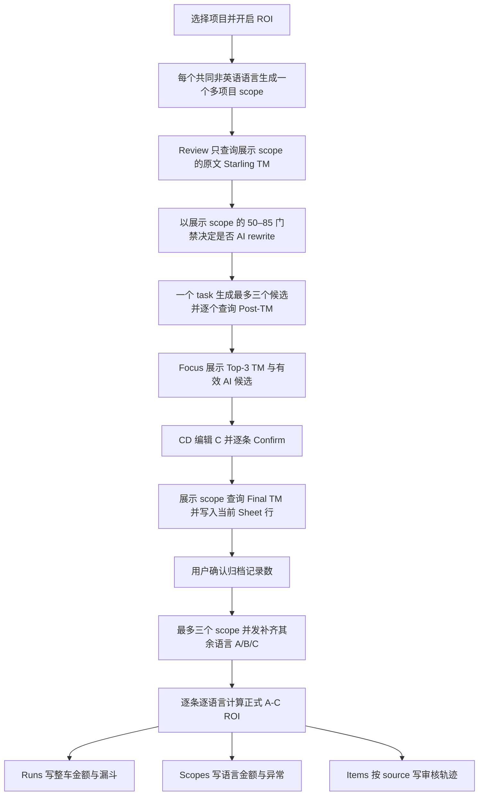

# 多语言整车 ROI

本文定义 L10n TM Companion 的多语言 ROI 业务逻辑、运行数据和失败语义。它是多语言成本计算的长期契约；`docs/popup-configuration.md` 定义 Popup 的通用配置交互，README 仅保留使用入口。

## 业务目标

用户提交一批英文 source 文案时，关注的是这批文案发布到全部需要翻译的目标语言后，经过 AI 辅助和 CD 最终确认，实际送翻版本相对原始版本能节省多少翻译费用。ROI 的计算范围是每个已选 Starling 项目及其被纳入本次 ROI 覆盖范围的目标语言，不能把单一语言的匹配率或价格外推到其他语言。

默认范围为全部已选项目共同支持的非英语 `targetLocales`。用户只开启 ROI，不选择 vendor 或语言；每个自动纳入的语言生成一个携带全部已选 `projectIds` 的 scope。项目组合没有共同非英语目标语言时，该组合不能启动 ROI 测算。

ROI mode 默认关闭。关闭时插件只运行一个快速 TM target scope，不加载费率、不构建多语言金额，也不允许确认 C 或写 archive；该运行产生 A/B 审阅结果，但不产生 ROI。用户显式开启 ROI mode 后，本文件定义的全部 scope、费率、C 验证与归档规则才生效。

## 核心定义

### 运行 scope

`locale scope` 是一个 `{ projectIds, sourceLocale, targetLocale }` 结构。它代表同一批 source 文案在全部已选 Starling 项目、一个目标语言中的独立 TM 和计费上下文。

一次运行至少有一个 locale scope。用户所选项目必须保持相同 source locale；每个非英语 target locale 必须同时属于全部项目的 `targetLocales`，并只生成一个包含全部项目 ID 的 scope。两个项目与二十一个共同非英语语言必须生成并查询二十一个 scope。

### 真实 TM 快照

每个条目在每个 locale scope 均保存以下运行内快照：

- `original_tm`：原始英文 source，版本 A 的第一次真实 Starling TM 结果与 Score A。
- `post_rewrite_tm`：AI 产生非空 rewrite，版本 B 的第二次真实 Starling TM 结果与 Score B；它只用于帮助 CD 审阅。
- `final_tm`：CD 在 Spreadsheet 中确认的最终英文文案，版本 C 的第三次真实 Starling TM 结果与 Score C。
- `not_required`：本条未发生 rewrite，计费时改写后快照与 `original_tm` 相同。
- `incomplete`：接口、返回数量、score 或分类不满足契约，绝不伪造 0 分或成功快照。

Starling 的匹配率由 `sourceLocale + targetLocale + projectIds` 决定。所有目标语言都必须独立查询，禁止把某一语言的分数复制、乘数外推或作为其他语言的结果。

### 语言金额与整车金额

对每条文案、每个 locale scope，版本 A 与版本 C 分别使用各自真实 TM score、英文词数、vendor 的精确 `source_locale + target_locale` 费率及匹配分档计算 TM 成本：

`official AI saving = TM cost(A) - TM cost(C)`

版本 B 不参与正式金额计算。完整翻译基线仍可作为业务参考字段，但不能替代正式的 A−C ROI。整车金额是所有 complete locale line 的逐行 A−C 差额求和，仍属于本地英文计词的预估，不替代 Elasticsearch 结算字数或 vendor 最终账单。

AI 关闭或 CD 未确认时，没有可用的最终 C，正式 ROI 必须保持 `incomplete`；系统不得把 A、B 或完整翻译基线伪装为 C。

## 费率和失败语义

费率始终严格按 `vendor + source locale + target locale` 解析。系统禁止默认价格、跨 vendor 借价、语言回退、按比例派生 T-only 价格和以 0 填补缺失值。

单个 locale scope 在以下情况标为 `incomplete`：

- 缺少精确语言对或仅有 hourly rate。
- 首轮或最终 C TM 查询失败、返回异常或 score 非法。
- 当前 source 尚未在 Focus 完成 Final TM 与单行 Sheet 写入，因而 review 状态不是 `confirmed`。
- 原文无法得到有效可计费词数。

Starling 当前不返回 100% 命中的 ICE、重复或审核计费分类。为使整车预估可用，缺分类的 100% 命中按 T-only 的 20% 计算，这是已知分类中成本最高的保守值，并标记为 `exact_unclassified_conservative`。

任一已选 locale scope 不完整时，整车状态必须是 `incomplete`。ROI_Test 的 Run 仍需输出所有可计算文案的 A−C saving 小计、`complete scope count / selected scope count`、未覆盖 scope 清单和每项具体原因。一个 scope 内的局部失败不能再丢弃其他完整文案的金额；subtotal 必须标为“已覆盖文案小计”，不得显示为完整整车 ROI。

## 用户交互

Popup 的 ROI 配置只有项目选择和一个 ROI 开关。项目选择确定共同 target locale 交集；开启 ROI 后自动排除英语及其变体，再按剩余语言生成 scope，每个 scope 携带全部项目 ID。RWS 与 Pactera 共用同一套 TM snapshot，并分别解析自己的精确费率。

单语言 TM 查看仍保留为结果明细能力，不再决定整车 ROI 的计费范围。Review 首屏和 Confirm 只执行一个展示 scope；其余自动语言 scope 在用户确认 ROI 归档后，以最多三个 scope 并发补齐真实 A/C TM，B 只保留在展示 scope。运行摘要应展示项目数、自动语言 scope 数和完成/总 scope 数；补算时展示当前语言与进度，避免将多语言批处理伪装为瞬时操作。

普通 Sheet 使用用户确认的动态布局，且不显示任何 ROI 费率、成本、saving、coverage 或状态。AI 候选只在 Focus 中展示；CD 选择候选或编辑最终 C，并逐条 Confirm。插件完成 protected-token 校验、Final TM 与单行六列写入后才把该条标为 confirmed，正式 ROI 使用该 Final TM。

需要跨运行审计时，插件固定写入 [ROI_Test](https://bytedance.larkoffice.com/wiki/J1RJwEf0FijMQQkceUkcZyqCnJc?table=tbls3B039S6J7zdT&view=vewSwbY6Ry)，Settings 不提供归档 URL 配置，历史 `roiArchiveUrl` 也不能覆盖该目标。结果页不显示 ROI 金额，`Write ROI archive` 在至少一条 confirmed 后启用；Runs 保存整车范围、金额、Operator 与三阶段漏斗，Scopes 每行保存一个 target locale 的覆盖、金额、漏斗与失败原因，Items 每行保存一个 source 的 A/B/C 审核轨迹。Items 不随 locale 复制，避免 source × locale 笛卡尔积。已有表缺少新字段时插件只增量创建缺失字段，同名字段类型冲突时正确失败。

ROI_Test 的查看权限完全由飞书分享设置控制，发布应用、上传插件或分享安装包不会自动产生用户记录。当前纯客户端使用 `user_access_token` 直接写入，因此写入者必须拥有 ROI_Test 编辑权限；如果要让插件用户只能提交而不能查看，生产方案必须改为应用身份代理持有 App Secret 并代写。ROI_Test 的显示名可修改，固定 URL token 和三张内部表名保持不变即可。

归档不依赖 Bitable Formula。首次归档会创建三张原始表和六个基础 grid view；插件把完整整车的 A−C 节省写到 Run，不完整整车写所有可计算文案的小计，完全没有可计算文案时金额留空。写入前分别读取三张表的记录总数，任一表在追加后超过 20,000 条就停止；写入按 `Run(writing) → Scopes → Items → Run(complete|incomplete)` 顺序执行。若写入或最终状态更新失败，系统尝试将已创建的 Run 标为 `write_failed` 并写入真实失败原因；既有同名字段类型不符合固定契约时归档直接停止。

## 执行流程

每个 locale scope 继续遵守 Batch TM 的已批准限制：project ID 始终至多十个，source 默认每请求十条；RD 批准且 PPE 复验后可显式提高到最多四十条。补算最多同时运行三个 scope，每个 scope 内只保留一个 Batch 请求并发；任何接口错误均按对应 scope 正确失败。

## 验收标准

1. 单项目默认生成该项目全部非英语目标语言的 scope，不提供手动取消入口。
2. 多项目自动采用全部项目共同支持的非英语目标语言；每个语言只生成一个携带全部项目 ID 的 scope。
3. 每个 scope 分别发起真实 TM 查询；RWS 与 Pactera 共用查询结果，并按各自 target locale 精确费率计价。
4. 只有 Final TM 和当前行六列写入均成功的 source 才成为 confirmed C；未确认 C 或任一步失败时 ROI 为 `incomplete`，绝不回退到 B。
5. 正式 ROI 严格为 A 的 TM 成本减 C 的 TM 成本；B 的 score 仅用于审阅。
6. Sheet 只保留当前动态 TM/CD 输出区，不写任何 ROI 字段或金额；Popup 也不显示 ROI 金额。
7. 归档后 Runs 保存整车 A−C 节省与漏斗，Scopes 保存每个 target locale 的金额与异常，Items 按 source 保存一次审核轨迹。
8. 自动化测试覆盖 A/B/C、CD 确认门禁、第三次 TM、延后 scope 并发、费率缺失、Sheet 无 ROI 写入、三层归档、基础视图与容量边界。
