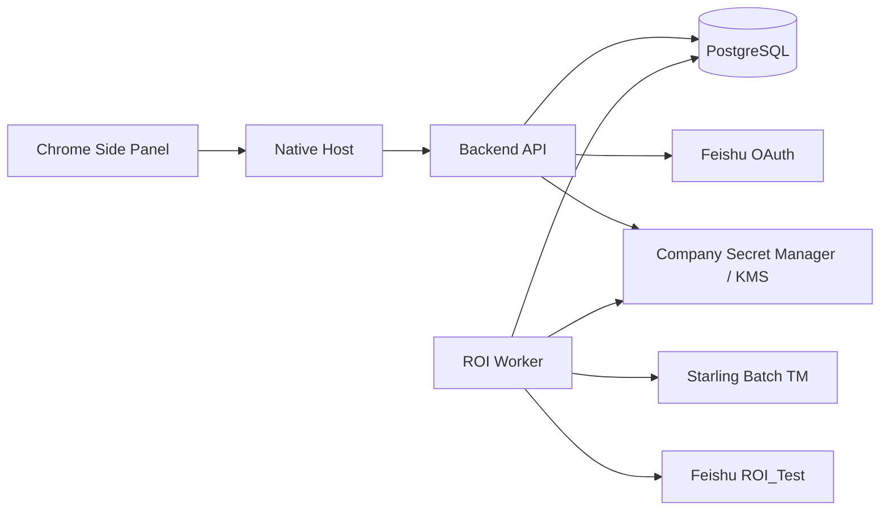
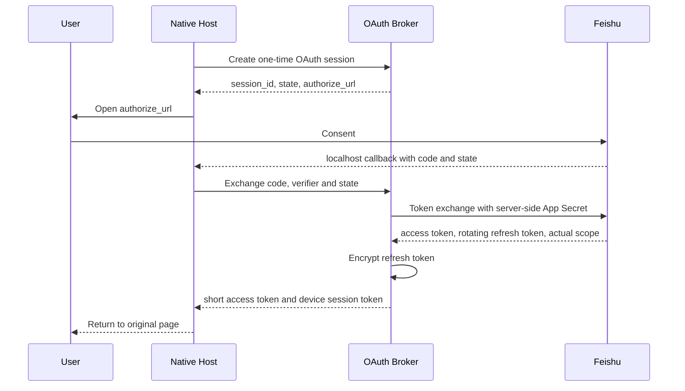

# OAuth Broker 与异步 ROI 服务

本文定义 L10n TM Companion 从本机 App Secret 和 Side Panel 同步 ROI，迁移到公司内部服务的目标架构、数据流、部署顺序和验收标准。`docs/oauth-broker-async-roi-contract.md` 固定 API、安全、状态与幂等实现契约；`docs/multilingual-roi.md` 继续定义金额语义；`docs/popup-configuration.md` 继续定义插件交互。这些长期规则不得被服务端改写。

## 目标与不变契约

本次建设解决两个问题：

- 普通用户安装生产插件后只点击 Authorize，不获取、不输入、不保存 Feishu App Secret。
- 全语言 ROI 的 TM 查询与 Bitable 写入不占用 Side Panel 生命周期；用户保存文案后由后台继续计算，关闭插件不终止任务。

以下契约保持不变：

- 正式 ROI 始终为 `TM Cost(A) - TM Cost(C)`；B 只用于审阅和质量漏斗。
- 当前展示 scope 的 Final TM 与 Working Sheet 写入仍是 `Confirm & save` 成功的同步门槛。
- 失败 scope 保持 `incomplete`，已覆盖金额只能标为 subtotal，禁止伪造完整整车 ROI。
- Starling 每次请求默认最多十条 source、始终最多十个 project ID；RD 批准并完成 PPE 复验后，服务可显式配置到最多四十条 source。
- 普通 Sheet 继续只写六列，不写 ROI 金额。

## 当前慢点

当前 `popup.js` 的 `writeCurrentRoiArchive()` 会调用 `completeDeferredRoiScopesForArchive()`，在 Side Panel 内补齐延后语言的 A/C TM，再由 `lib/roi-bitable-archive.js` 写入 RWS/Pactera 的 Runs、Scopes 和一组 Items。这个路径仍依赖 Popup 内存，并把全语言补算集中到归档前。

OAuth 当前由 `native-host/feishu_oauth.py` 从 macOS Keychain 读取 App Secret，再调用 Feishu OAuth v2 token endpoint。普通用户必须先拿到 Secret，无法作为正式分发方案。

## 最小架构

在当前仓库新增一个 `backend/` 服务模块、两个进程和一个 PostgreSQL 数据库。API 与 Worker 使用同一版本代码；Worker 通过 PostgreSQL `FOR UPDATE SKIP LOCKED` 领取持久任务，不默认增加 Redis。公司已有标准任务队列时，可以替换领取实现，但不得改变实现契约中的状态机、事务边界和幂等键。

API 管理公司调用方身份、OAuth session/grant、ROI run、状态查询和归档请求。Worker 管理 Starling 批量查询、A−C 计价、Feishu tenant token 和 ROI_Test 写入。App Secret、Starling 服务身份和数据加密密钥只从公司 Secret Manager 注入服务端。

## OAuth Broker

### 用户流程

保留 localhost callback 和 PKCE，把授权码交换与刷新移到 Broker：

OAuth session 五分钟有效且一次性使用。Broker 只接受精确 allowlist 中的 localhost redirect URI，并校验公司身份、state、PKCE、scope 和授权码状态。长期 `device_session_token` 保存到 macOS Keychain，服务端只保存 hash；短期 Feishu access token 可以沿用当前 Chrome storage，以兼容 Working Sheet API。refresh token 永不返回插件。

长期刷新使用 grant endpoint，不复用五分钟 OAuth session。服务端按 grant 串行化 refresh，并使用 `refreshing → active | refresh_uncertain` 正确处理“Feishu 已轮换但数据库未提交”的崩溃窗口；该窗口要求用户重新授权，禁止伪装刷新成功或重复消费旧 token。

### 权限与安全

现有 `FEISHU_USER_SCOPE` 请求集合增加 `offline_access`。应用 Owner 需要开启 refresh user access token 的安全设置、登记 localhost redirect URI、发布新版本，并让 Pilot 用户重新授权一次。Working Sheet 使用用户身份 token；ROI_Test 使用 Worker 持有的 tenant token，因此插件用户可以提交归档但不会自动获得 ROI_Test 查看权限。

服务通过公司 HTTPS 网关暴露。网关必须验证员工或设备身份、删除外部伪造身份头，再注入可信 subject；对象授权按 `tenant + owner subject` 执行。App Secret、refresh/access token、authorization code、PKCE verifier、device token、source A/C 均不得进入日志、指标、trace 或错误响应。长期凭证和业务内容使用公司 KMS envelope encryption。

生产构建编译时移除 App Secret 设置；Keychain Secret 流程只允许存在于明确标记的开发构建，不做运行时静默降级。

## 异步 ROI

### 服务端 policy

普通 CD 不再选择 vendor 和 ROI languages。服务端加载版本化 ROI policy；每个 target locale 必须恰好映射到一个 vendor 和精确按词费率。Starling project IDs 来自用户选择并经服务端按当前 subject 权限重新验证的项目集合，不由费率 policy 注入。每个 run 固化 policy 与 rate catalog hash，历史 run 不随费率更新重算。

Localization/Finance 必须确认约 56 个 locale 的唯一 vendor、重叠优先级、未覆盖语言处理和生效日期。会议中的“Pactera 约 21 个、RWS 覆盖其余”只作为待确认输入，不能直接变成生产规则。重复 locale、缺 vendor、缺精确费率或只有 hourly rate 时，服务拒绝启用自动 ROI。

### 计算时机与提速

1. 插件创建 run 时一次性提交并封存全部 A；Worker 立即预计算全部 policy locales 的 Score A 和 Cost A。
2. 当前展示 scope 的 A、B、C 继续在插件内完成，保持现有快速审阅和 Sheet 确认语义。
3. 每条 `Confirm & save` 完成 Final TM 与 Sheet 写入后，插件提交最终 C；Worker 只计算全部 policy locales 的 Score C 和 Cost C。
4. Worker 不为全部语言重复查询 B；B 只保留展示 scope，用于 AI uplift 与审阅证据。
5. 用户点击 Archive ROI 后，API 封存 C、创建持久 archive job 并立即返回；Worker 等封存前任务到达终态，再写 Runs、Scopes、Items。

Worker 对短时间连续确认做两秒 debounce，按 locale 依据 `L10N_STARLING_BATCH_SIZE` 合并 source；默认值为 10，客户端允许的最高值为 40。一个 run 只允许选择一至十个已验证 project ID。N 条 source、L 个 locale 的单阶段请求数为 `L × ceil(N / batch_size)`；18 条、约 56 locale 在默认 10 条时，A/C 理论请求由约 2016 次降为约 224 次。真实 batch size、QPS、并发和重试上限必须由 Starling Owner 审批，并由 PPE 负载测试确定。

### 一致性与失败

run 创建在一个数据库事务中写入 run、items、A jobs 和 outbox。每条 C 同样在一个事务中保存内容、递增 revision 并创建 C jobs，避免数据已保存但后台任务丢失。Archive 固化 confirmed/unconfirmed items、policy 和任务集合；封存后再提交 C 返回冲突，归档完成后的金额快照不被晚到结果修改。

状态使用四个正交字段：`a_state`、`review_state`、`c_state` 和 `archive_state`。pending 不算 incomplete；Archive 后任务先重试到成功或 terminal failure，未确认 item 和 terminal failure 才进入最终 incomplete。每个 complete item-locale pair 计入 subtotal，任一 locale scope 不完整时整车状态为 incomplete。

插件所有写请求使用 Idempotency-Key。任务唯一键覆盖 `run + item + locale + stage + text hash + policy version`。C 文案变化只 supersede 该 item 的旧 C result。Worker 只重试网络超时、429 和平台 5xx；参数、协议、策略、权限、身份和内容冲突正确失败。

ROI_Test 按 Run ID 防重：零条才创建，一条按 record ID 续写，多于一条立即失败。写入顺序保持 `Run(writing) → Scopes → Items → Run(complete|incomplete)`，并保存每条 record ID 与写入阶段。

## 插件接入

Native Host 调用内部服务，避免 Chrome CORS 和新增 host permission。完整 request/response schema、HTTP 状态码、身份与对象授权、refresh 恢复、coverage 和归档算法见 `docs/oauth-broker-async-roi-contract.md`。

主要接入点：

- `native-host/feishu_oauth.py`：保留 localhost callback 与 PKCE，替换本机 Secret exchange。
- `lib/feishu-auth.js`：增加 device session、Broker refresh 和 `offline_access`。
- `native-host/starling-bridge.py`、`background.js`：增加 Broker 与 ROI API 的 Native Messaging actions。
- `popup.js`：创建 run，确认成功后提交 C，归档改为后台 job，删除生产路径对 `completeDeferredRoiScopesForArchive()` 的调用。
- `lib/multilingual-runner.js`：保留本地对照与测试，不承担生产阻塞路径。
- `lib/multilingual-roi.js`、`lib/roi-calculation.js`、`lib/roi-bitable-archive.js`：作为金额、subtotal 与 Runs/Scopes/Items 的迁移 oracle。
- `data/local-rates.json`：只作为 rate catalog 初始冻结输入，不直接推导 locale vendor policy。

普通 UI 在未连接时只显示 Authorize；Review 展示后台 coverage、ready 或 incomplete 状态。`Confirm & save` 只等待当前展示 scope Final TM、Sheet 写入和后台 enqueue accepted。enqueue 失败必须显示真实错误并允许显式重试。`Archive ROI` 不等待 TM 或 Bitable；重新打开 Side Panel 后按 run ID 恢复状态。Backend 不可用时禁用新的自动 ROI run，禁止静默回到旧同步全语言生产路径。

## 开发与部署

推荐使用公司批准的 Python 服务模板；没有统一模板时使用 Python 3.11+、FastAPI、Pydantic、SQLAlchemy/Alembic 和 PostgreSQL。API 与 Worker 复用 domain module，OpenAPI 由 schema 生成，不得把浏览器 payload 直接透传为 Feishu record body。

### 阶段 A：OAuth Broker

1. 建立 backend、migration、Secret Manager/KMS、HTTPS 路由和公司身份验证。
2. 实现 session、exchange、device session、refresh 状态机、revoke、日志脱敏与审计。
3. 完成 Feishu `offline_access`、refresh 设置、redirect URI 和新版本发布。
4. 插件接入 Broker，生产构建隐藏本机 Secret。
5. 在测试环境验证无 Secret 新 Mac 授权、过期与并发刷新、撤销、缺 scope、崩溃窗口和重新授权。
6. Pilot allowlist 开启，稳定后删除部门分发 Secret 的说明。

### 阶段 B：ROI Worker

1. 收齐已签署 policy、Starling 服务身份、endpoint、QPS、并发和重试契约。
2. 实现 run、items、scope results、jobs/outbox 和 A/C 计算，先关闭 ROI_Test 写入。
3. 用同一 3 条和 18 条样本运行旧客户端与服务端 shadow compute，逐 item、locale 对齐 Score A/C、Cost A/C、saving 和 incomplete。
4. 差异清零或书面解释后，开启 PPE ROI_Test 写入，验证容量、Run ID 防重与中途续写。
5. 通过 100 条负载与故障注入后启用 Pilot，观察延迟、请求数、上游错误、重复记录和 incomplete 原因。

### 阶段 C：生产切换

先启用 OAuth Broker，再启用 async ROI，最后启用 ROI archive write。发布新插件并让旧用户重新授权一次。至少观察一个完整 Pilot 周期后再显式删除旧 Keychain App Secret；删除动作必须可审计。最终更新长期文档和 handoff，记录真实地址、版本、策略、测试与回滚。

## 生产门禁

以下信息缺失时可以开发和部署关闭 feature flag 的服务，不得打开生产流量：

1. 公司服务平台、HTTPS 域名、Native Host 身份验证方式、Secret Manager 和 KMS。
2. Feishu Owner 对 `offline_access`、refresh 设置、新版本和 Broker 访问的确认。
3. Starling 服务端身份、PPE/Production endpoint、QPS、并发与重试规则。
4. Localization/Finance 签署的 locale→vendor→rate policy。
5. ROI_Test 的应用身份编辑权限、PPE 目标和固定 schema。
6. source A/C、Sheet 标识、日志和备份的数据保留与删除政策。

## 验收标准

OAuth 必须满足：

- 从未配置 Secret 的 Mac 安装生产包后，只点击 Authorize 即可授权、读取用户资料并读写本人有权限的 Sheet。
- App Secret 不出现在安装包、Chrome storage、Keychain、Native Messaging 响应、日志、trace、数据库和浏览器 Network 响应。
- access token 过期后自动刷新；两个并发请求获得同一新 token/version；崩溃不确定窗口要求重新授权。
- state、PKCE、redirect URI、重复 code、过期 session、缺 scope、跨用户对象访问和 revoke 测试正确失败。

ROI 必须满足：

- `Confirm & save` 的同步路径只增加一次轻量 enqueue，不随 locale 数线性增长。
- 关闭 Chrome 或 Side Panel 后 Worker 继续，重新打开后按 run ID 恢复。
- 相同 A/C 重放不增加 Starling 请求，修改 C 只重算对应 item。
- 正式金额逐 item、locale 与当前实现一致，严格使用 A−C；缺失输出 subtotal 与真实原因。
- Archive 从 API 收到请求到 `202 accepted` 的 PPE P95 不超过一秒，后台重试不产生重复 Run。
- Worker 在 Starling 超时、Feishu 429、进程终止、数据库重连和归档中断后从持久状态恢复。

性能验收记录旧版与新版在 3、18、100 条样本上的用户阻塞时间、后台总时间、P50/P95、请求数和失败率。后台完成时间不预设虚假数字；至少要求 Confirm 不再随 locale 数线性增长，Archive 不再等待 TM 与 Bitable。

## 交付物

内部 Agent 必须提供 backend 源码、migration、OpenAPI、部署配置、feature flags、仅含 secret 名称和用途的变量清单、插件 adapter、升级与回滚说明、单元/集成/故障注入/负载测试及已检查输出、dashboard、告警、runbook 和最终 handoff。最终 handoff 必须区分本地测试、PPE 部署、Pilot 启用与生产启用，并记录 commit、环境、真实地址、Feishu 发布状态、Starling 审批和未验证边界。

## 外部接口依据

- [Feishu 获取 user_access_token](https://open.feishu.cn/document/authentication-management/access-token/get-user-access-token?lang=zh-CN)
- [Feishu 刷新 user_access_token](https://open.feishu.cn/document/authentication-management/access-token/refresh-user-access-token?lang=zh-CN)
- [Feishu Token 类型选择](https://open.feishu.cn/document/faq/trouble-shooting/how-to-choose-which-type-of-token-to-use?lang=zh-CN)
- [Feishu 服务端 API 调用流程](https://open.feishu.cn/document/server-docs/api-call-guide/calling-process/get-?lang=zh-CN)
