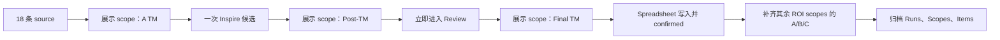

# Review 性能与 ROI 分析结构实施计划

## 目标

CD review 必须优先完成当前展示语言的 TM 查询、Final TM 和 Spreadsheet 写入，不能因为一次运行选择了全部 ROI 语言而等待完整多语言计算。ROI 仍严格使用 `TM Cost(A) - TM Cost(C)`，并在归档前补齐全部所选语言的真实 A/C TM 快照。

ROI_Test 使用三个稳定粒度：

- `L10n ROI Runs`：一条记录对应一次运行。
- `L10n ROI Scopes`：一条记录对应一次运行中的一个 target locale。
- `L10n ROI Items`：一条记录对应一次运行中的一个 source，不与 locale 做笛卡尔积。

## 业务流程

首屏和 Confirm 的交互完成条件只依赖当前展示 scope 与 Spreadsheet。其余语言失败时，Review 仍保持 confirmed，ROI 状态按真实完成度标记 `incomplete`，不能用展示 scope 分数代替缺失语言。

## 性能约束

- Starling 单请求最多 10 条 source。
- 跨 scope 查询必须使用全局受控并发，避免“每个 scope 五并发”叠加为无界请求。
- UI 显示当前阶段、完成 scope 数、待处理 source 数和失败数。
- 保存每个阶段的 wall-clock duration 与请求计数，性能结论只基于实测。

## ROI 字段

Scopes 增加 source 数、已覆盖 source 数、A/B/C 达标数、完整翻译成本、A TM 成本、C TM 成本和 A-C Saving。金额只在该 scope 有可计算条目时写入；不完整 scope 保留小计与失败原因。

Items 保存 Run ID、source 稳定键、Sheet 行号、Source、展示 scope、Score A、Score B、Final C、Score C、AI 是否选用、Review 状态和 Operator。每个 source 每次运行只写一条。

## 视图

初始化过程只增量创建缺失视图，不删除或替换用户已有视图：

- Runs：Management overview、Operator adoption、Quality funnel。
- Scopes：Locale performance、Exceptions。
- Items：Source review audit。

若服务端视图 API 无法表达聚合或图表，创建基础筛选/排序视图并保留仪表盘为 Owner 在 ROI_Test 中配置的展示层，不伪造成功。

## 测试与交付

每项行为先加入失败测试，再实现最小代码。完成后运行定向测试、全部 JavaScript/Python 测试、离线安装器 dry-run、ZIP 内容/签名/凭证扫描，并增量更新 README、用户手册、ROI 原理文档和 E2E checklist。

## 当前进度

- 已完成展示 scope 优先、最多三个 scope 受控并发、归档前延后补算与单 scope Confirm。
- 已完成 Runs/Scopes/Items 固定 schema、source-grain Items、语言级金额与漏斗、六个基础 grid view、三表顺序写入和 20,000 条容量预检。
- 已完成 OAuth scope 增量、旧 token scope 完整性检查、`base:record:retrieve` 记录检索修复、Popup 三表确认与成功摘要、1.3.2 版本和正式文档更新。
- 已完成全部自动化测试、安装包构建、内容核验、敏感信息扫描与真实飞书 E2E 边界记录；真实 Sheet/ROI_Test 写入保留为用户重新授权后的下一步。
