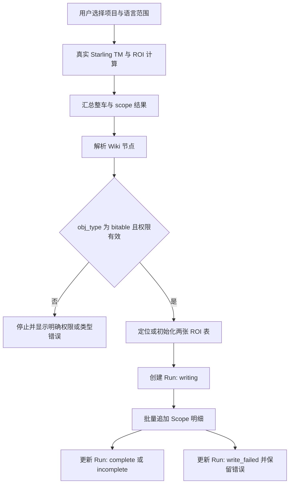

# ROI 多维表格归档设计

## 目的与边界

L10n TM Companion 在一次多语言 TM 运行结束后，将“整车完整翻译成本减去当前 TM 预估成本”的结果归档至用户指定的飞书多维表格。归档支持整车摘要和 `project × target locale` 明细，不保存逐文案、逐语言的成本明细。

ROI 金额继续遵守 `docs/multilingual-roi.md`：每个 scope 使用真实 Starling TM 结果和精确 vendor 语言对费率计算；任一已选 scope 不完整时，整车状态为 `incomplete`，金额字段只能代表“已覆盖语言小计”。系统不得以默认价格、语言回退或零金额伪造完整 ROI。

现有 Spreadsheet 的 A-G 文案处理与 CD review 工作流保持不变。Bitable 只承担跨运行 ROI 审计与看板职责，不取代 Spreadsheet。

## 目标位置与访问方式

用户配置一个 ROI Bitable Wiki URL，例如：

`https://bytedance.larkoffice.com/wiki/J1RJwEf0FijMQQkceUkcZyqCnJc?table=tblhAsRIfpsbd9d1&view=vew797j4Lp`

URL 的 wiki token 是节点标识，不是 Bitable App Token。插件获取 tenant access token 后调用 Wiki 节点信息接口，只有返回 `obj_type = bitable` 时才接受该目标，并将 `obj_token` 作为 Bitable App Token。`table` 和 `view` 查询参数仅用于识别用户当前打开的表和视图，归档表本身通过固定名称在同一 App 内定位。

若 Wiki 节点不是 Bitable、飞书应用没有 Wiki 或 Bitable 权限、应用未被加为知识空间或 Bitable 协作者，初始化必须停止并显示服务端原因。系统不尝试将 Wiki token 当作 App Token，也不切换到其他输出目标。

## 数据模型

归档使用同一 Bitable App 内的两张新表。首次显式初始化时创建，后续运行按表名定位并校验字段，避免重复创建。

### L10n ROI Runs

每次用户主动运行的整车 ROI 对应一条记录，主字段为 `Run ID`。该 ID 在运行开始时生成，在两张表之间作为稳定连接键。

| 字段 | 类型 | 含义 |
| --- | --- | --- |
| Run ID | 文本，主字段 | 唯一运行标识 |
| Run at | 日期时间 | 运行开始时间 |
| Write status | 单选 | `writing`、`complete`、`incomplete`、`write_failed` |
| Source segments | 数字 | 本次英文 source 条数 |
| Vendor | 文本 | 费率使用的 vendor |
| Projects | 多行文本 | 已选项目 ID 或名称清单 |
| Selected scopes | 数字 | 纳入 ROI 分母的 scope 数 |
| Complete scopes | 数字 | 金额完整的 scope 数 |
| Coverage | 文本 | `Complete scopes / Selected scopes` |
| Full translation USD | 数字 | 完整翻译成本或已覆盖语言小计 |
| TM estimated USD | 数字 | TM 预估成本或已覆盖语言小计 |
| Saving USD | 数字 | 节省金额或已覆盖语言小计 |
| Incomplete scopes | 多行文本 | 未覆盖 scope 与机器原因 |
| Pricing notes | 多行文本 | 例如 `exact_unclassified_conservative` 的适用说明 |

`Write status = complete` 时三个金额字段代表完整整车 ROI。`Write status = incomplete` 时它们代表已覆盖语言小计，`Incomplete scopes` 必须非空。`write_failed` 不得被视为 ROI 计算完成。

### L10n ROI Scopes

每个 `project × source locale × target locale` 对应一条记录，主字段为人类可读的 scope key。`Run ID` 采用文本连接键，按该字段筛选即可查看某一次运行的全部明细，避免为看板增加双表关联字段的两阶段写入。

| 字段 | 类型 | 含义 |
| --- | --- | --- |
| Scope | 文本，主字段 | 项目与语言对的可读标识 |
| Run ID | 文本 | 对应 `L10n ROI Runs.Run ID` |
| Project | 文本 | Starling 项目 ID 或名称 |
| Source locale | 文本 | 源语言 |
| Target locale | 文本 | 目标语言 |
| ROI status | 单选 | `complete` 或 `incomplete` |
| Source segments | 数字 | 该 scope 的文案条数 |
| Full translation USD | 数字 | scope 完整翻译成本 |
| TM estimated USD | 数字 | scope TM 预估成本 |
| Saving USD | 数字 | scope 节省金额 |
| Failure reasons | 多行文本 | 不完整时的精确原因 |
| Pricing notes | 多行文本 | 保守计价或其他可审计说明 |

不完整 scope 的金额字段留空，不填零。已有的用户表 `tblhAsRIfpsbd9d1` 不被读取、修改或作为这两张归档表的 schema 依据。

## 运行与写入流程

ROI 计算先在内存中完整结束，Bitable 不参与 TM 或费率计算。初始化与写入均通过 tenant access token 完成；Scope 记录按飞书单批上限切分。系统只在用户点击“初始化 ROI 归档”或“写入 ROI 归档”后执行外部写入。

Run 记录先以 `writing` 建立，随后追加所有 Scope 记录，最后更新为 `complete` 或 `incomplete`。若 Scope 写入或最终状态更新失败，插件尝试将 Run 标为 `write_failed` 并显示原始 API 错误；无法完成该状态更新时也必须把写入失败呈现给用户，不能显示“归档成功”。

## Popup 交互

Options 新增独立的 `ROI archive Bitable` 配置项，允许粘贴 Wiki 或 `/base/` URL。Popup 在当前页为 Bitable 或 Wiki-Bitable 时可自动建议该 URL，用户仍可使用手动配置覆盖。

结果页显示“Write ROI archive”按钮，并在写入前展示目标 Bitable、将创建或复用的两张表、待写入的一条 Run 与 N 条 Scope。首次初始化和每次写入都需要用户确认。Spreadsheet 的“Write back to sheet”按钮继续只操作单一查看 scope 的文案结果。

## 验证与验收

自动化测试至少覆盖：

- Wiki URL 解析为 node token、table ID、view ID，并成功解析为 Bitable App Token。
- Wiki 节点返回非 Bitable、无权限、App Token 缺失时正确失败。
- 首次初始化创建两张表和规定字段，重复初始化不创建重复表。
- 字段缺失或类型不符时停止且报出差异。
- `complete` 运行写入一条 Run 和所有 Scope，金额与 Popup 汇总一致。
- `incomplete` 运行写入已覆盖小计、完整覆盖计数和失败 scope，绝不伪造完整金额。
- Scope 写入失败时 Run 变为 `write_failed` 或将状态更新失败完整暴露。
- 原有 Sheet A-G 写回、TM-only 快路径和当前 Bitable 文案处理测试不回归。

端到端验证使用专用测试 Bitable，确认实际创建表名、字段类型、Run/Scope 条数、金额、`incomplete` 文案和失败状态均与 Popup 输出一致。生产目标表未经用户点击确认不得写入。

## 不在本次范围内

- 将每条 source 在每个目标语言下的成本写入 Bitable。
- 自动训练、SFT 或 LoRA 数据沉淀。
- 对已有 `tblhAsRIfpsbd9d1` 表进行字段迁移或数据修改。
- 从 Bitable 反向驱动 TM 处理输入。
