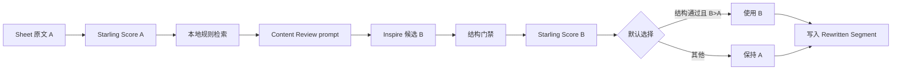

# Content Review Skill 与审阅流程集成设计

## 目标

L10n TM Companion 在保持现有 A/B/C、Starling TM、Feishu Sheet 与 ROI 数据契约的前提下，引入用户提供的 `cd-content-review-version-2` skill、Style Guide、Glossary、Game Legal Guidelines 和 Revenue Legal Guidelines，提升 Inspire 英文改写候选质量，并完成结果审阅体验与既有错误分类修复。

## 业务规则

- 单条最终选择为 `保持原文 A`、`使用 AI 候选 B`、`人工编辑`；TM source 与 target translation 只作为证据，不直接写入英文最终 Source。
- 结果卡片、Focus 导航和写回使用 Sheet 真实行号升序；异步任务完成顺序不得改变展示顺序。
- Starling 的 `tm_source` 原文保持不变；UI 额外生成可读预览，简化受支持的 `{{...}}` 包装与控制标签，未知表达保留 raw 并正确失败。
- Content Review skill 与其 reference 原样保存。运行时使用完整 Baseline Quality Check，并从 Style Guide、Glossary 和唯一一份 Legal Guidelines 中确定性检索相关片段。
- Game/Revenue Legal 只能选择一份。明确的 game mechanics、gameplay、player、game task/reward 场景选 Game，其余 LIVE Revenue 场景选 Revenue；选择结果写入候选审计信息。
- AI 候选必须逐字符保留现有 placeholder、URL、数字与 ICU/模板 token。结构校验失败或真实 Score B 不高于 Score A 时，默认保持 A。
- Working spreadsheet 缺失不得被 storage 中的 `starlingProjectIds` 误分类为 TM 故障。

## 数据流

## 文件边界

- `skills/cd-content-review-version-2/`：原样保存 skill、principles 与四份 Markdown snapshot。
- `lib/content-review-rules.js`：解析 Markdown、Glossary 匹配、Legal 选择、相关章节检索与规则包加载。
- `lib/source-rewrite-policy.js`：TM display preview、结构 token 提取、候选门禁与默认选择。
- `lib/ai-translate.js`：只负责把规则上下文和单条输入组装为 Inspire JSON prompt。
- `popup.js` 与 `lib/i18n.js`：审阅选择、顺序和可见状态。
- `scripts/build-offline-package.sh`：将 skill 资产完整复制进 Installer payload。

## 失败语义

- 规则文件缺失、为空或读取失败时停止 AI 改写，不使用无规则 prompt 降级。
- Glossary 无命中可以继续，但 prompt 必须记录 `No matching glossary term`。
- 无法解析的 TM 模板只影响 display preview，raw 仍用于审计与 Starling。
- AI JSON 结构异常、结构 token 改变或 Score B 未提升时保留候选证据，但默认选择 A。

## 验收

- 自动化测试覆盖规则资产、检索、Legal 单选、prompt、结构门禁、保持 A、行号顺序、TM preview 和错误分类。
- 全量 JavaScript、Python、syntax、diff、Installer contract 和离线构建验证通过。
- Installer.app、ZIP、正式交付目录和已安装扩展中的版本与规则文件哈希一致。
