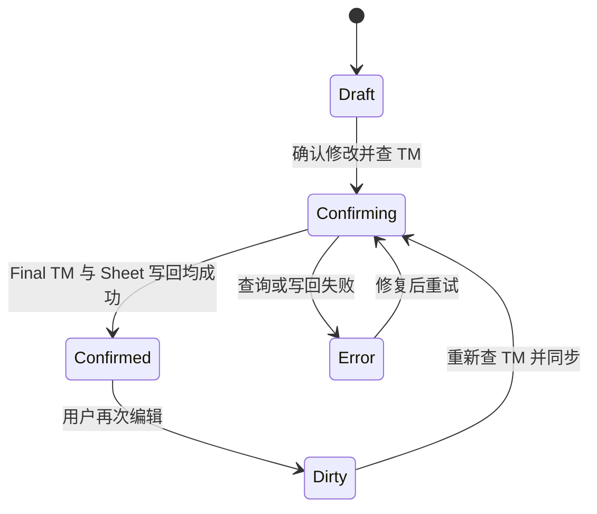
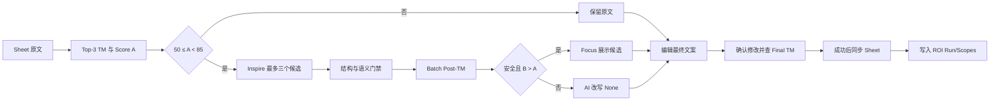

# Top-3 TM、改写审阅与 ROI 归档简化设计

## 目标

L10n TM Companion 将 Top-3 TM、英语改写、人工确认和 ROI 归档收敛为一条可理解、可重复操作的主流程。用户只需读取原文、专注审阅、确认修改并查询 TM、写入 ROI；A/B/C 仍作为内部数据语义存在，不要求用户理解。

本设计遵循以下优先级：

1. 最终英文文案语义、Glossary、Legal、Style Guide、placeholder、URL、数字和模板 token 正确。
2. 所有 TM 分数来自 Starling 真实查询。
3. AI 只展示安全且相对原始 TM 有提升的候选。
4. 页面优先简洁，审计信息保留在数据模型、Sheet 和 ROI_Test 中。

## 范围与非目标

本轮范围包括 Batch TM Top-3 数据契约、50–85 改写梯度、多候选生成与筛选、结果卡片和 Focus 简化、逐条最终确认与自动 Sheet 同步、ROI Run 漏斗指标、既有 Sheet 与 Bitable schema 迁移。

本轮不增加 Source String Key、项目元数据或 `/project/search`，不改变 Starling 的服务端评分算法，不以 LLM 自评分替代真实 TM Score，不新增 `L10n ROI Items`，不改变正式 ROI 的 A−C 金额口径。

## 核心业务定义

- A：Sheet 原始英文文案及其真实 Starling TM Score。
- B：AI 生成并通过安全门禁的英语改写候选及其真实 Post-TM Score。
- C：用户在 Focus 中最终确认的英文文案及其真实 Final TM Score。
- 正式 ROI：`TM Cost(A) - TM Cost(C)`。
- AI 效果：A 到有效 B 的达标数量变化，仅用于过程分析。
- 人工效果：在已确认样本中，A 到 C 的达标数量变化。
- 达标：真实 Starling TM Score 大于等于 85。

UI 使用“原文、AI 改写、最终文案”，不展示 A/B/C 术语。

## 改写梯度

自动 AI 改写严格使用以下区间：

- `Score A < 50`：只显示 Top-3 TM，不调用 AI。
- `50 ≤ Score A < 85`：调用 AI 生成候选。
- `Score A ≥ 85`：保留原文，不调用 AI。

边界值 85 已经达标，不进入 AI。区间判断使用 Starling 原始数值，不先四舍五入。

## Top-3 TM 数据契约

Batch TM 请求继续使用现有 `/corpus/tm/match/batch` 和 `limit=3`。Starling 返回的每个候选数组按服务端顺序保留，不对同一 source 额外查询三次。

Bridge 在兼容现有最佳匹配字段的同时增加：

```text
tm_candidates: [
  {
    source,
    target,
    score,
    origin,
    source_lang,
    target_lang,
    match_category,
    tm_id
  }
]
```

`tm_match`、`tm_source` 和 `similarity` 继续映射第一名，避免破坏现有 Sheet、ROI 与旧快照。候选按 `source + target` 去重，重复项保留最高分；缺失字段保持空值，非数值 score 或非数组响应必须正确失败。

Top-3 检索本身不增加 Batch 请求数。三个 AI 候选的 Post-TM 重查会增加待查询 source 数量，仍按每批最多十条发送并记录实际请求数与耗时。

## AI 候选生成与筛选

每条符合梯度的 source 只创建一个 Inspire task。Prompt 输入原始 source、Top-3 TM source、Content Review Principles、相关 Style Guide、Glossary 和唯一一份 Legal Guidelines，最多返回三个结构化候选。

目标优先级固定为：

1. 保持 source 原意及业务信息。
2. 保持受保护 token 逐字符一致。
3. 遵守 Glossary、Legal 与 Style Guide。
4. 在前三项成立时，参考 Top-3 TM 的结构和措辞提高真实 TM Score。

候选不得把 TM target translation 当作英文改写素材。LLM 不输出“语义覆盖度 98%”或“流畅度 90%”等未经校准的百分比，也不参与最终 TM 排名。

每个候选经过以下门禁：

1. JSON 与必需字段结构有效。
2. placeholder、URL、数字和模板 token 完整。
3. 语义判断为 `same_meaning`，`needs_context` 与 `meaning_changed` 均不可推荐。
4. Post-TM 查询状态为 `complete`。
5. Post-TM Score 严格大于 Score A。

通过的候选按真实 Post-TM Score 降序展示，最多三条。全部候选未通过时，UI 显示 `AI 改写：None`；拒绝原因保留为内部审计状态，不展示无价值的候选文本。

每条 source 同时保留一个代表性 Post-TM 结果：存在安全且提升的候选时取最高分有效候选；不存在有效候选但至少一次 Post-TM 查询完成时，取最高分已查询候选，仅展示分数、升降和简短拒绝原因，候选文本仍显示 `None`；没有成功完成的 Post-TM 查询时分数为空。这样下降结果可以显示 `Post-TM 48% ↓7`，又不会把无效改写交给用户。

## 统一升降规则

Post-TM 与 Final TM 都以原始 Score A 为唯一基线，避免用户在多个变化基线之间切换。

- 大于 A：`↑{delta}`。
- 小于 A：`↓{absolute delta}`。
- 等于 A：`→0`。

示例：

```text
TM           55%
AI 改写      None
Post-TM      48% ↓7
最终文案     Users can customize...
Final TM     90% ↑35
```

AI 候选只有上升且通过安全门禁时展示文本。人工最终文案始终展示，即使 Final TM 下降，因为它是用户的明确业务决策；下降结果允许继续编辑和重新确认。

## 页面与交互

### 主流程页

步骤标题保持“1. 原文”。主按钮改为：

`读取原文 → 查询 TM → AI 改写`

一次点击完成 source 读取、Top-3 TM、梯度判断、AI 生成和 Post-TM 查询，完成后自动进入结果页。Working Spreadsheet 保持自动检测，手动选择继续作为 fallback。

该批处理只读取 Sheet 并生成审阅结果，不提前改写 Sheet。原有主流程页和结果页的两个“写回表格”按钮删除，避免与逐条确认的自动同步形成第二套入口。

### 结果卡片

卡片按 Sheet 原始行号排序，只显示原文摘要、`TM`、`Post-TM`、`Final TM` 和确认状态。删除 `AI rewrite` 徽标，AI 文本是否存在由 Focus 内容表达。

删除“展开详情”。点击卡片或“专注查看”进入同一 Focus，避免维护两套详情交互。

### Focus

Focus 是唯一审阅入口，依次展示：

1. 完整原文。
2. Top-3 TM source、target translation 与真实分数。
3. 通过门禁的 AI 候选；没有有效候选时显示 `None`。
4. 可编辑的最终文案。
5. `TM`、`Post-TM`、`Final TM` 与相对 A 的升降。

Focus 保留上一条、下一条和关闭操作。用户可以保留原文、采用 AI 候选或直接编辑最终文案。

### 逐条确认

主按钮为“确认修改并查 TM”，每条文案独立执行。状态机为：



确认动作按固定顺序执行：

1. 校验最终文案非空及受保护 token。
2. 查询最终文案的真实 Final TM。
3. 查询成功后写入最终文案与 Final TM 到 Sheet。
4. Sheet 写入成功后才标记 `confirmed`。

任一步失败都保持未确认状态并显示真实错误。用户再次编辑已确认文本时立即进入 `dirty`，旧 Final TM 标记为过期，按钮变为“重新查 TM 并同步”。

逐条确认在普通模式与 ROI mode 中都可使用。普通模式查询当前 Fast TM scope 并同步 Sheet；ROI mode 对当前已选 scope 查询最终结果，卡片展示当前查看 scope 的 Final TM，全部 scope 结果用于正式 ROI。

删除全局“确认最终 C 并计算 Score C”按钮和 `CD review valid?` 下拉。逐条确认本身构成明确的人工确认。

## Sheet schema

输出区保持六列：

1. `Best TM Match`
2. `Orig Match %`
3. `Rewritten Segment`
4. `Post-TM %`
5. `Reached 85%?`
6. `Final TM %`

`Rewritten Segment` 保存当前最终文案。`Post-TM %` 保存代表性 Post-TM 分数；AI 文本显示 `None` 时仍可保存已完成查询的下降、持平或被门禁拒绝分数，没有成功查询时为空。`Final TM %` 保存确认后的 C 分数。`Reached 85%?` 在确认后按 Final TM 更新，确认前按有效 B 或 A 的当前结果显示。

旧 Sheet 的第六列表头为 `CD review valid?` 时：

- 数据区为空：自动改名为 `Final TM %`。
- 存在任意值：停止迁移，明确提示用户备份或清理该列，禁止覆盖人工数据。
- 其他字段名或类型异常：保持现有 schema mismatch 失败语义。

## ROI_Test Run 指标

每次写入 ROI 时，`L10n ROI Runs` 复用现有 `Run at` 和 `Source segments`，并新增：

- `Operator`：文本，当前写空值。
- `Pretranslation ≥85`：全部 source 中 Score A 达标数量。
- `After AI ≥85`：全部 source 的有效 AI 阶段结果达标数量；只有通过安全门禁且提升的 B 才能替换 A，被拒绝候选即使 Post-TM 分数更高也沿用 A。
- `AI uplift to ≥85`：`A < 85` 且有效 AI 阶段结果大于等于 85 的数量。
- `CD reviewed segments`：已完成逐条确认的数量。
- `After Review ≥85`：已确认 C 中 Final TM 达标数量。
- `Review uplift to ≥85`：在相同已确认样本中，`A < 85` 且 `C ≥ 85` 的数量。

漏斗统计使用条目数，不使用字符数或英文词数。金额计算继续使用本地英文词数与精确 Vendor 费率。

固定 ROI_Test 中缺少上述字段时，插件只创建缺失字段；同名字段类型不符时正确失败，不修改既有数据。无字段管理权限或高级权限不足时保留飞书原始错误并给出需要的字段清单。

`L10n ROI Scopes` 继续保存 coverage、失败原因和定价说明，不新增逐条记录或 B 金额。

## ROI 写入交互

删除结果页的 Final C 全局按钮，只保留“写入 ROI”。至少一条文案成功确认后启用按钮。

确认窗口显示：

- 本次 source 总数。
- 已确认与未确认数量。
- A、有效 AI 阶段、最终人工阶段达到 85% 的数量。
- 将写入的固定 ROI_Test 与 Run/Scope 记录数。

部分确认允许归档，但未确认条目保持 `incomplete`，金额只能表示已覆盖文案小计。零条确认时禁止归档。

## 数据流



## 失败语义

- Starling Top-3 响应异常：停止当前 TM 阶段，不使用本地 BM25 或旧结果伪装。
- Inspire 失败：保留 A 与 Top-3 TM，AI 显示 `None` 并保留真实错误。
- 候选全部下降、持平或不安全：AI 显示 `None`，不展示候选文本。
- Final TM 失败：不写 Sheet、不确认、不写该条正式 ROI。
- Final TM 成功但 Sheet 写入失败：保持未确认，允许重试写回或重新确认。
- ROI schema 缺字段：只补缺失字段；类型冲突或权限不足时停止写入。
- 部分确认：归档状态为 `incomplete`，保留有效小计和缺口。

## 验收标准

- 49.99、50、84.99、85 四个边界值严格符合改写梯度。
- Batch TM 一次请求保留每条最多三个候选，不额外执行三次相同查询。
- Top-3 映射、去重、顺序和旧最佳匹配字段均有回归测试。
- AI 下降、持平、语义风险和 token 风险均显示 `None`，候选文本不进入 UI。
- Post-TM 与 Final TM 的箭头和 delta 都以 A 为基线。
- 删除展开详情、AI rewrite 徽标、Final C 全局按钮和 CD review 下拉。
- 删除两个全局写回按钮，批处理不改 Sheet，逐条确认是唯一业务写回入口。
- 每条确认严格执行校验、Final TM、Sheet 写回、confirmed 四阶段。
- 再次编辑会使旧 Final TM 过期，并允许重新查询和同步。
- 旧 Sheet 空 CD review 列可安全迁移，非空列正确失败。
- ROI Run 新字段使用同一批条目和明确定义的分母，正式金额保持 A−C。
- 部分确认与权限、schema、网络错误均正确失败或标记 incomplete。
- 用户手册、TM Matching、ROI 规则、E2E checklist、安装包与版本说明在实现验证后增量同步。
