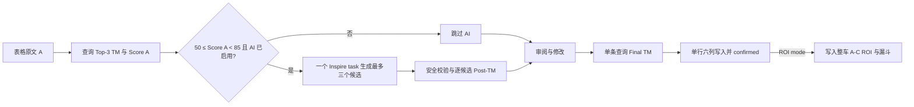

# L10n TM Companion 使用教程

本教程面向使用飞书表格、Starling TM 和 ROI_Test 的内容运营、CD 与本地化同学。默认快速运行得到原文 A、Starling Top-3 TM 与真实 Score A；启用 AI 后，只有 `50 ≤ Score A < 85` 的 source 创建一个 Inspire task，最多生成三个结构化候选。CD 只需在“Review & edit / 审阅与修改”中修改例外项，其余默认结果可以批量确认；插件查询 Final TM、同步对应 Sheet 行，ROI mode 开启时再计算 A-C 整车节省。



## 先理解三个版本

| 版本 | 内容 | 用途 |
| --- | --- | --- |
| A | 原始英文文案 | 第一次 TM 查询，得到 Score A |
| B | 通过安全门禁的 AI 英文候选 | 第二次真实 TM 查询，得到 Post-TM Score，供 CD 审阅 |
| C | CD 在“审阅与修改”中确认的最终英文文案 | Final TM 查询和当前行写回均成功后成为 confirmed，也是实际送翻文案 |

正式节省只按 `TM Cost(A) - TM Cost(C)` 计算。Score B 不进入 ROI 金额。

> A/B/C 是文案版本名，和 Spreadsheet 的列字母不是同一件事。`Best TM Match` 保存第一名 TM 英文 source；`Rewritten Segment` 只在单条确认成功后写入最终 C。

## 安装体验与限制

推荐入口是离线包中的 `安装 L10n TM Companion.app`。它内置 universal Python、Node.js LTS 与固定版本 Starling CLI，从 `manifest.json` 公钥计算稳定的 32 位扩展 ID，先自检本机 bridge，再原子写入 Chrome Native Messaging Host 清单，并在桌面创建可直接选择的插件目录入口。已有 Python、Node.js 或 npm 不影响安装：私有运行时只存在插件目录中，不修改用户环境。

当前流程属于“引导式双击安装”，不能做到完全无人值守：Chrome 出于安全原因要求用户本人开启开发者模式并确认“加载已解压的扩展程序”；安装 App 目前没有 Apple Developer ID 签名与 notarization，从下载包首次打开时可能需要右键 App 后选择“打开”。安装器会显示原生进度窗口，并在桌面创建名称清楚的加载入口，用户可直接点击选择，不依赖路径快捷键；安装器不会绕过两项系统安全确认。

### 安装前准备

解压后可以直接运行安装器，不需要把交付包移到固定位置。安装器会把实际运行文件复制到 `~/L10n TM Companion - Chrome 加载这个文件夹`，并在桌面创建同名入口；安装完后可以删除下载的 ZIP 和解压目录。Starling 个人中心和 Inspire 通常要求公司账号及办公网络或 VPN；没有对应权限时服务验证会直接显示真实错误。

| 依赖 | 用途 | 获取与验证 |
| --- | --- | --- |
| macOS + Chrome 114+ | 扩展与 Native Messaging 运行环境 | [下载 Chrome](https://www.google.com/chrome/)；地址栏打开 `chrome://version` 查看版本 |
| Python 3 | 运行本机 bridge | universal 私有副本已封装；用户无需安装 |
| Node.js LTS | 运行 Starling 官方客户端 | universal 私有副本已封装；用户无需安装 |
| Starling CLI 1.1.41 | TM 查询与官方签名 | 固定版本与双架构 keytar 已封装；安装器不运行 npm |

### 推荐安装步骤

1. 双击 `安装 L10n TM Companion.app`；若 macOS 阻止打开，右键 App，选择“打开”，再确认一次。
2. 安装器检查包内 Python、Node.js 与 Starling CLI，然后完成固定扩展 ID、bridge ping 与 Native Host 注册，并打开 Chrome 扩展页和 Finder 中的安装目录。失败时会打开 `/tmp/l10n-tm-companion-installer.log`，按照最后一条错误处理。
3. 在 `chrome://extensions` 右上角开启“开发者模式”，点击“加载已解压的扩展程序”；在文件窗口左侧点击“桌面”，选择 `L10n TM Companion - Chrome 加载这个文件夹`，不要进入或选择 `native-host` 子目录。
4. 完全退出 Chrome：按 `Cmd+Q`，确认 Dock 中 Chrome 不再有运行指示，再重新打开。只刷新扩展不能保证 Chrome 重新读取 Native Host 清单。
5. 打开扩展卡片的“详情”并点击“扩展程序选项”，进入 Settings；固定扩展 ID 应为 `bgbodpcofifiloekhfjiffmchcaiiicm`。

后续升级时直接运行新版安装器；它会替换稳定安装目录并保留上一版备份。卸载时先从 `chrome://extensions` 移除扩展，再删除 Native Host 清单、桌面入口和 `~/L10n TM Companion - Chrome 加载这个文件夹`。

需要先检查但不安装时，在 Terminal 运行：

```bash
./native-host/install.sh --dry-run --no-open
```

### 安装后健康检查

在 Settings 依次完成以下检查：

1. 点击 Starling 区的 `Test connection`，应看到 Native Host 与 CLI 正常。
2. 填写 Starling AK/SK 后点击 `Save & Verify`，应显示可访问项目数量。
3. App ID 已固定；普通用户在 Side Panel 首页点击 `Authorize`，在系统浏览器完成授权。有效回调会优先关闭授权标签页并回到发起授权的原页面；若浏览器阻止自动关闭，则把当前标签页跳转回原页面。Side Panel 随后应立即显示姓名、user ID 和头像。
4. 保存设置，回到飞书 Spreadsheet 打开 Side Panel；顶部不应再显示 `Setup required`。

`Test Feishu connection` 只验证当前 Spreadsheet 连接；Wiki node、Bitable table/field/record 权限会在第一次 `Write ROI archive` 时真实验证。

`Access to the specified native messaging host is forbidden` 通常表示 Chrome 尚未重启、加载的不是桌面上指定的文件夹，或 Native Host 清单仍指向旧路径。确认扩展 ID 是上面的固定值，重新运行安装器，再完全退出并重开 Chrome；仍失败时查看 `/tmp/l10n-tm-companion-installer.log` 和 `chrome://extensions` 中该扩展的“错误”，把完整错误交给维护者。

## Settings 配置：去哪里申请、复制什么

下面这些值都属于个人或应用凭证。只复制到扩展 Settings 的对应输入框，不要发到群聊、截图、文档、代码或日志中。

| Settings 字段 | 去哪里获取 | 复制什么 | 是否必需 |
| --- | --- | --- | --- |
| Starling Access Key / Secret Key | [Starling 个人中心](https://starling.bytedance.net/personal_center#aksk) | 完整 AK 与完整 SK，分别粘贴到两个密码框 | TM 必需 |
| Inspire Agent | 程序内置 | 固定调用真实验证的 `TM_inspire` Version 7 | 用户无需填写 Agent ID 或 version |
| LLM API Key | Inspire Pilot owner 提供的个人 OpenAPI key | 以 `wak_` 开头的个人 Access Key | AI 使用 Inspire 时必需 |
| Feishu account | 已发布的 L10n TM Companion 飞书应用 | 普通用户在首页点击授权；Owner 本机测试先完成 Keychain setup，正式分发使用 OAuth broker | 读写 Spreadsheet 与记录 ROI Operator 必需 |
| ROI archive Bitable | 程序固定为 [ROI_Test](https://bytedance.larkoffice.com/wiki/J1RJwEf0FijMQQkceUkcZyqCnJc?table=tbls3B039S6J7zdT&view=vewSwbY6Ry) | 无需填写 URL | 仅需确保应用和当前用户具有归档权限 |

### Starling TM

1. 打开 [Starling 个人中心](https://starling.bytedance.net/personal_center#aksk)，申请或查看个人 AK/SK。
2. 在 Settings 分别粘贴完整 AK 与 SK，点击 `Save & Verify`；成功后插件会真实读取当前账号可访问的项目，不会使用默认项目伪装成功。
3. `Starling CLI path` 通常留空；只有自动检测失败时，才在 Terminal 运行 `which starling-cli`，把返回的绝对路径粘贴进去。
4. `TM query mode` 保持 `Batch TM API in PPE`。默认每个请求最多 40 条 source，bridge 最多并发 5 个批次并保持输入顺序；维护者可受控降低至 1–40 条，`Legacy single-text` 只用于排障。

AK/SK 会同时保存在 Chrome `storage.local` 和 Starling 官方本机配置中，默认遮挡但可回填；两处都属于本机持久化，不提供硬件级加密。

个人中心无法访问、没有 AK/SK 申请入口或验证后项目列表为空时，联系目标 Starling 项目的 Owner 或管理员确认账号、项目权限和办公网络；不要借用他人的 AK/SK。

### Inspire Writer

1. 打开 [Inspire Writer](https://inspire.bytedance.net) 并使用公司账号登录；产品说明见 [Inspire Prototype 指南](https://bytedance.larkoffice.com/wiki/D8PswE6azi4d4uk4ep7cyxoPnfc)。
2. 在 `My` 页面创建个人 OpenAPI Access Key；如果页面没有入口，在飞书中搜索并联系 Inspire Pilot owner，申请个人 `wak_…` Access Key。插件固定调用 `TM_inspire` Version 7，普通用户无需填写 Agent ID、version 或 teamId；当前 Pilot 对接人是逯鹏宇。
3. Settings 勾选 `Enable AI rewrite`，Provider 选择 `Inspire Writer`，粘贴个人 Access Key。Endpoint 自动填为 `https://inspire.bytedance.net/writer/api`，一般不要修改。
4. Model 必须从 Settings 下拉框选择，无需手输内部 ID；配置示例中的 `gemini_3f` 是 `Gemini 3 Flash` 的 API 值。批量日常改写推荐 `Gemini 3 Flash + low`；更重视质量时使用 `GPT 5.4 mini + medium`；`GPT 5.4 + high` 最慢，只建议用于少量关键文案或二次复核。模型是否可用取决于当前 Agent、Pilot 白名单与 Inspire 服务端枚举；出现 `Invalid option` 时重新加载最新扩展并改选当前下拉框中的可用模型，不要自造模型名。

插件只改写英文 source，不翻译 target。运行状态显示 `finished / total`、活跃任务数与累计 polls；poll 是插件检查异步任务状态的一次请求。单次 HTTP 最多等待 30 秒，单个 task 总计最多等待 120 秒。100 QPS 只是客户端请求 gate 的代码上限，不是账号获批配额，也不代表可以用 100 QPS 压测；服务端真实额度由 Inspire 平台决定。返回 429、400 或 5xx 时插件保留原始错误，不会伪装成功。

task 显示 `completed` 后如果第一次 `/copies` 暂时没有可用 pass copy，插件会在同一 task 上进行最多两次只读重试，不会重复创建任务。三次仍为空时继续正确失败，并在错误中报告 copies 数量、pass copy 数量、字段名和 prompt 字符数，便于区分异步可见延迟、响应 schema 变化与输入体积问题。

关闭 `Enable AI rewrite` 时 Starling TM 仍正常运行：所有条目都有 Top-3 TM 与 Score A，Focus 允许人工编辑最终 C。启用 AI 但 key 或模型不完整时，`50 ≤ Score A < 85` 的条目显示真实配置错误；该问题不影响已经完成的 Score A。

### 飞书自建应用与文档权限

1. 打开[飞书开放平台](https://open.feishu.cn/app)，创建企业自建应用，或选择团队已经批准的应用。
2. 在“权限管理”为用户身份申请电子表格元信息查询 `sheets:spreadsheet.meta:read`、查看 `sheets:spreadsheet:read`、编辑 `sheets:spreadsheet:write_only`，以及 `wiki:node:read`、`base:table:read`、`base:table:create`、`base:field:read`、`base:field:create`、`base:record:read`、`base:record:retrieve`、`base:record:create`、`base:record:update`、`base:view:read`、`base:view:write_only`、`contact:user.base:readonly` 和 `contact:user.employee_id:readonly`。Bitable 权限与接口可从[飞书新增数据表 API 文档](https://open.feishu.cn/document/server-docs/docs/bitable-v1/app-table/create)和[新增视图 API 文档](https://open.feishu.cn/document/server-docs/docs/bitable-v1/app-table-view/create)核对。
3. 进入“版本管理与发布”创建版本并发布；权限需要管理员审批时，等审批通过后再测试。只在后台勾选但没有发布的权限不会对正式调用生效。
4. 在“安全设置”登记 `http://localhost:39641/l10n-tm-companion/oauth/callback`。本机 Owner 测试先在 Settings 展开 `Application owner setup`，通过 macOS 隐藏输入框把 Secret 保存到 Keychain，再从 Side Panel 首页点击 `Authorize`。普通用户不得收到 App Secret；正式分发前必须部署服务端 OAuth broker。
5. 当前纯客户端直写模式要求用户本人对目标 Spreadsheet 和 ROI_Test 具有可编辑权限。API 权限已发布只代表接口能力，不会自动安装插件、授权用户或授予某份文档权限。
6. ROI archive URL 已固定为 [ROI_Test](https://bytedance.larkoffice.com/wiki/J1RJwEf0FijMQQkceUkcZyqCnJc?table=tbls3B039S6J7zdT&view=vewSwbY6Ry)，Settings 不再提供 URL 输入框，升级时也会清理历史 `roiArchiveUrl`。首次归档会自动创建 `L10n ROI Runs`、`L10n ROI Scopes` 与 `L10n ROI Items`，增量建立固定字段和基础视图；同名表已存在时只校验并复用，同名字段类型不符会正确停止并报 `schema mismatch`。
7. 从旧版本升级到 1.3.0 后，需要在 Side Panel 首页重新授权一次，使旧 token 获得记录读取与视图读写 scope；无需重新填写 Starling 或 Inspire 凭证。
8. 1.3.1 起，旧 token 缺少当前必需权限时，首页会列出缺失 scope 并显示 `Reconnect`；应用管理员仍需先发布包含新增权限的应用版本。
9. 1.3.2 起，容量预检使用的“列出记录”接口显式请求 `base:record:retrieve`；`base:record:read` 只覆盖特定记录读取，不能替代该权限。
10. 1.3.3 起，插件只接受飞书 token 响应实际返回的 scope；1.3.2 及更早 token 会要求重新授权一次。若实际 token 仍缺权限，Owner 必须先创建并发布包含该用户身份权限的新应用版本，再让用户点击 `Reconnect`。

### 配置示例

以下只展示格式，不能照抄示例凭证：

```text
Starling AK:      <从 Starling 个人中心复制完整值>
Starling SK:      <从 Starling 个人中心复制完整值>
LLM Provider:     Inspire Writer
Inspire Agent:    TM_inspire Version 7，已内置，无需填写
LLM API Key:      wak_<个人 OpenAPI Access Key>
LLM endpoint:     https://inspire.bytedance.net/writer/api
Model:            gemini_3f
Thinking level:   low
Feishu App ID:    已内置，无需填写
Feishu App Secret:<维护者安全提供，仅首次输入>
ROI archive:      已固定为 ROI_Test，无需填写
```

### 准备飞书电子表格

Working spreadsheet 不绑定固定文档。自动模式采用当前打开的任意已授权 `/sheets/` 或 Wiki 挂载电子表格；`Use a different spreadsheet` 允许粘贴另一份链接形成手动选择，`Use current page` 恢复自动模式。Wiki node token 会先通过 Wiki API 解析成真实 Spreadsheet `obj_token`，解析失败或共享应用没有文档权限时直接停止并显示错误。

来源列和数据起始行可以不同。Working spreadsheet 会检查 A-Z 前二十行，识别 `Original Source Segment`、`English Source` 或 `Source`；也可以手动选择来源列和起始行。确认后的结果使用以下六列：

| 顺序 | 字段 | 谁来填写 |
| --- | --- | --- |
| 1 | `Best TM Match` | 插件写入 |
| 2 | `Orig Match %` | 插件写入 Score A |
| 3 | `Rewritten Segment` | 插件写入“审阅与修改”中确认的最终 C |
| 4 | `Post-TM %` | 插件写入所选有效 AI 候选的真实 Post-TM；纯人工文案可为空 |
| 5 | `Reached 85%?` | 插件按 Final TM 是否达到 85 写入 |
| 6 | `Final TM %` | 插件写入最终 C 的真实 Final TM |

初次查询只在 Side Panel 展示结果，不写 Sheet。CD 可以在“Review & edit / 审阅与修改”中单条点击 `Confirm & save`，也可以用结果页的 `Confirm & save remaining` 批量确认其余默认结果。批量流程仍逐项通过本地门禁并查询 Final TM，再把相邻 Sheet 行合并成连续 B-G 区间写入；Final TM 或 Sheet 写入失败的条目保持未确认。普通 Spreadsheet 不显示任何 ROI 金额。

插件会在写入前检查来源列与输出六列是否重叠，并检查输出表头。空表头会初始化；旧六列表头仅在 `CD review valid?` 数据区为空时迁移，发现任意旧人工 review 值会停止并报告冲突。首次在正式表格使用时建议先复制一个 Sheet，用两至三条样本确认列布局；插件不提供一键撤销。

## 日常操作

### 选择本次运行范围

1. 打开存放文案的飞书电子表格，再点击扩展图标打开 Side Panel。
2. 勾选一至十个当前账号有权限的 Starling 项目。普通 CD 路径不显示 target language；程序自动选择全部项目共同支持的第一个 locale 作为内部 Starling 查询参数。
3. 普通 CD 运行保持 ROI mode 关闭；此时费率和多语言 coverage 不参与查询。
4. 需要整车计价时只开启 ROI mode。程序自动覆盖全部项目共同支持的非英文目标语言，并对 RWS 与 Pactera 同时计算；用户不选择 Vendor 或语言。
5. 在 `Working spreadsheet` 选择 Spreadsheet 与 Sheet，确认来源列、数据起始行、输出起始列和前五条 source 预览。

快速路径把全部已选项目与一个共同 target locale 合成单个 Batch scope。ROI mode 开启后，程序取全部项目 target locale 的交集，排除全部英语变体；每个共享语言生成一个携带全部已选项目 ID 的 Batch scope。Review 首屏保留 A/B 供 CD 选择候选；其余语言以最多三个 scope 并发补齐正式 ROI 所需的 A/C TM，不会按语言重复查询候选 B。RWS 与 Pactera 只复用这些 TM 快照各自套用精确费率；某 vendor 缺少精确语言费率时，该 vendor 的 scope 保持 `incomplete`，不会借用另一家价格。项目之间没有共同非英文目标语言时插件会明确停止 ROI 运行。

### 生成 A 与候选 B

1. 点击 `Read source → Query TM → AI rewrite`。
2. 插件查询 A 的 Starling Top-3 TM，第一名得分是 Score A。
3. `49.99` 跳过 AI，`50` 与 `84.99` 进入 AI，`85` 跳过 AI；每条进入 AI 的 source 只创建一个 Inspire task，最多保留三个结构化候选。
4. Inspire Writer 的 `status=pass` copy 先由客户端去重并包装为内部结构化候选，再校验 placeholder/token、URL、数字、品牌 token、Prompt 中的 Legal 与 meaning-preservation 契约，最后查询真实 Post-TM；`status=fail`、空 copy 与原样 source 不进入候选列表。
5. 通过全部安全校验且 Post-TM 查询完整的候选进入“Review & edit / 审阅与修改”可选列表；`Post-TM > Score A` 的候选自动作为初始 Final copy，持平或下降候选保留原文为默认值并继续提供人工选择。没有安全候选时显示 `None`，并在下方显示 AI 关闭、配置缺失、API 失败、结构错误或安全门禁原因。

Score A 低于 50 或达到 85 时，插件不会发起 Inspire task，但 CD 仍可在“Review & edit / 审阅与修改”中手工填写最终 C。

结果卡片严格按 Sheet 原文行号排列，使用 `TM → Post → Final` 分阶段颜色、相对 Score A 的箭头和用户状态标签，只保留 `Review & edit / 审阅与修改`。Review 顶部的 `All / AI rewritten` 筛选显示各自数量；`AI rewritten` 展示通过安全门禁且真实 Post-TM 完整的条目，下降或持平候选同样可审阅，筛选不会改变确认、写回与归档范围。审阅视图默认折叠 Top-3 TM 与多 AI 候选，完整显示 Source，并提供可自动伸缩的最终 C 编辑框；内部 `dirty` 状态显示为 `Edited · confirm again / 已修改，需重新确认`。升级时必须运行新版安装器并完全退出 Chrome 后重开；只刷新扩展无法更新 Native Host。旧 Host 仅返回首条 TM 时，审阅视图会保留该条真实命中并明确提示升级，不会把正分显示成 `No TM match`。

Inspire 的改写 prompt 使用安装包内版本化保存的 TM Alignment Prompt、Content Review skill、Content Review Principles，以及按场景选择的唯一一份 Game 或 Revenue Legal Guidelines。相关证据经过确定性检索并受字符预算约束，Writer native copy 协议固定在 prompt 首尾；规则文件缺失时 AI 改写会停止并显示真实错误，不会退回无规则 prompt。`/copies` 只接受 `status=pass` 的非空 copy；短文案没有安全改写空间时 Agent 原样返回 source，客户端将其解释为 skip 而不是 AI 候选。

### 在“Review & edit / 审阅与修改”逐条确认最终 C

默认快速路径和 ROI mode 都使用同一个审阅确认入口。

1. 点击某条结果的 `Review & edit`，选择一个有效 AI 候选，或直接编辑最终英文文案 C。
2. 点击该条的 `Confirm & save`。
3. 插件先检查最终 C 非空且 protected token 与 A 完全一致，再查询 Final TM。
4. Final TM 完整后，插件把当前行六列写入 Working spreadsheet；全部成功才显示 confirmed。
5. 已保存文案再次编辑后显示 `Edited · confirm again / 已修改，需重新确认`，必须点击 `Confirm changes & save`；旧 Final TM 不再有效。

### 批量确认其余默认结果

只在“Review & edit / 审阅与修改”中编辑真正需要调整的条目。编辑完成后回到结果页，点击 `Confirm & save remaining`；已经 confirmed 的条目会跳过，未确认条目使用当前 Final copy 执行同一套 protected token 门禁、真实 Final TM 查询和 Sheet 写入。候选默认文本在进入审阅视图前已经通过结构、URL、数字、语义、风险与 Post-TM 门禁；人工直接编辑的文本视为 CD 明确业务决策，确认阶段仍会重新检查 protected token 与 Final TM。批量写回按真实行号排序，相邻行合并为连续六列区间，空洞行保持独立区间，避免覆盖未包含在本次确认中的数据。失败项保留原文案并显示 `Save failed / 保存失败`，其余成功项显示 `Saved / 已保存`。

关闭 Side Panel 后，插件只会在同一份 Spreadsheet 和同一个 Sheet 中恢复最近运行快照；切换目标或启动新运行会使旧快照不可用，因此完成归档前不要切换 Sheet 或开始新运行。

### 写入整车 ROI

1. 至少一条 source 显示 confirmed 后，点击 `Write ROI archive`；零确认整车禁止归档。
2. 核对确认窗口中的固定 ROI_Test 链接，以及 `1 Run + N Scopes + M source Items` 的记录数；取消不会补算延后语言或写入飞书。
3. 确认后，插件补齐尚未查询的语言 scope，再按 Runs → Scopes → Items → Run 最终状态的顺序写入。

无需在 Settings 配置归档链接，也不需要创建 Formula 或手工建表。首次归档会自动增量创建缺失的三张表、字段和基础视图，不会删除或替换既有数据。

当前写入会把授权用户的 `name`、`user_id`、`open_id` 和头像 URL 记录在 Run 与 source audit 中，因此 ROI Owner 能审计是谁执行了归档。应用发布、插件上传和 ROI_Test 链接本身不会产生用户；记录只会在用户安装插件、完成授权并实际归档后出现。ROI_Test 可以改显示名，只要固定 Wiki token 与三张内部表名不变。

## 在 ROI_Test 查看结果

打开 `L10n ROI Runs`，按最新 `Run ID` 查看本次整车信息：

| 字段 | 含义 |
| --- | --- |
| `Write status` | `complete` 表示所有已选 scope 完整；`incomplete` 表示存在未覆盖语言或最终 C 缺失 |
| `Operator` / `Operator User ID` | 本次归档的飞书用户名与稳定用户 ID |
| `Operator Open ID` / `Operator Avatar URL` | 应用内用户标识与头像地址 |
| `Coverage` | 完整 scope 数 / 已选 scope 数 |
| `Full translation USD` | 完整翻译的参考成本 |
| `TM estimated USD` | 原文 A 的 TM 预估成本 |
| `Saving USD` | 正式 `A-C` 节省金额 |
| `Pricing notes` | 说明金额是完整整车金额还是已覆盖文案小计 |
| `Pre-translation at 85` | 首轮 Score A 已达到 85 的条数 |
| `After AI at 85` | AI 有效候选使代表分数达到 85 的累计条数 |
| `AI uplift to 85` | AI 相对首轮新增达到 85 的条数 |
| `CD reviewed segments` | 已成功逐条确认并写回的 source 数 |
| `After review at 85` | Final TM 达到 85 的累计条数 |
| `Review uplift to 85` | 人工确认相对 AI 阶段新增达到 85 的条数 |

`L10n ROI Scopes` 用于定位语言贡献与覆盖问题。每一行是一个携带全部项目 ID 的 target locale scope，包含语言级 `Full translation USD`、`TM Cost A USD`、`TM Cost C USD`、`Saving USD`、三阶段漏斗和 `Failure reasons`。同一批 TM 快照会分别写入 RWS 与 Pactera 两套 Run/Scope 记录；source-grain `L10n ROI Items` 只写一次，避免重复审阅数据。

`L10n ROI Items` 用于 source 审核追踪。每条 source 每次 Run 只写一条记录，保存 Source、Best TM Match、Score A、AI rewrite、Score B、Final copy、Score C、确认状态与 Operator；它不会按 locale 复制，因此 18 条 source 与 35 个语言只生成 18 条 Item，而不是 630 条。

插件会幂等创建 `Management overview`、`Operator adoption`、`Quality funnel`、`Locale performance`、`Exceptions` 与 `Source review audit` 六个基础 grid view。飞书视图创建 API 只支持名称和类型，具体分组、筛选、字段显隐及仪表盘由 ROI_Test Owner 在飞书界面一次性维护；普通使用者无需逐次设置。三张表写入前会检查飞书每表 20,000 条记录上限，达到上限时在写入前明确失败并提示归档历史表。

当 `Write status=incomplete` 时，插件仍会汇总所有成功得到 A/C TM 与费率的文案，金额代表“已覆盖文案小计”。只有一条文案都无法计算时金额才保持空白，避免把未知金额写成 0 或完整整车节省。

TM Cost 由每个 target locale scope 的 RWS 或 Pactera 精确费率、本地英文词数和真实 TM Score 计算，再汇总为各自的整车金额。AIPE 是 AI post-editing 单价，T-only 是纯翻译单价；0–75 分按 AIPE 计价，(75,85]、(85,95]、(95,100) 分别按 T-only 的 60%、40%、20% 计价。100% 按 Starling 返回的 ICE/repetition/exact 分类计价；没有分类时保守按 T-only 的 20% 估算并记录 `exact_unclassified_conservative`。完整规则见[多语言 ROI 规则](multilingual-roi.md)。

## 常见问题

### Confirm 后仍未 confirmed

按该条 Focus 中的真实错误处理。常见原因包括 protected token 改变、Final TM 查询不完整、Working spreadsheet 指向错误、旧六列表头下已有审阅数据，以及单行写入失败。修正后重新点击该条 Confirm；系统不会把失败状态伪装为成功。

### `incomplete`

这是覆盖状态，不是系统崩溃。打开 `L10n ROI Scopes`，查看 `Failure reasons`：常见原因包括 `final_source_text_missing`、`final_tm_missing`、`final_tm_query_failed` 和 `rate_missing_language_pair`。

ROI 自动覆盖全部共同非英文语言。RWS 与 Pactera 的费率目录语言覆盖是互斥的（RWS 为欧语系，Pactera 为亚洲与中东语言），因此每种语言只会进入真正为它报价的那家 vendor 的 Run：欧语系归 `-rws` Run，亚洲与中东语言归 `-pactera` Run，某家 vendor 没有任何可计费语言时不再生成该 Run。当某语言被路由到其他 vendor 时，本 Run 的 `Pricing notes` 会写入一行 `Vendor locale routing: …`，说明本 Run 只覆盖部分语言、不是整车全语言金额。

只有当某 vendor **确实服务该语言但缺少按字费率**（例如只有 hourly rate、费率行重复或费率配置未更新）时，对应 scope 才会显示 `rate_missing_language_pair` 或 `rate_missing_word_rate` 并保留其他完整 scope 小计。这类情况反映真实费率目录缺口，需要补费率表，不影响 TM 查询本身。

### `ROI archive schema mismatch`

现有同名字段类型不符合当前固定结构。插件会自动创建缺失字段，但不会改写类型冲突；把完整报错和对应 Runs、Scopes 或 Items 表的字段截图发给插件维护者核对。

### 非 Inspire Provider 提示 URL 或 endpoint 错误

本节只适用于 Claude、DeepSeek 或 Custom Provider；Inspire Endpoint 保持自动填写值，不按本节修改。TM 查询可以正常工作，其他 AI Provider 需要独立的 LLM endpoint。像 `ep-xxxx` 的部署 ID 不是 URL，不能填入 Endpoint；需要向对应 AI 平台确认完整 API Base URL、模型/部署名称以及 OpenAI 兼容的请求格式。

## 使用边界

- AI 只改写英文 source，不翻译 target language。
- 每次运行最多选择十个 Starling 项目；TM 文案默认由桥接按十条一批处理，已批准环境可以显式提高到最多四十条。
- Vendor 费率只使用插件内置的 `local-rates.json` 快照，不会借用其他 Vendor 的价格。
- `Saving USD` 是 TM 计费规则下的预估，不替代供应商最终结算。

更详细的配置与业务规则见 [Side Panel 配置说明](popup-configuration.md)、[多语言 ROI 规则](multilingual-roi.md) 与 [ROI_Test 金额说明](roi-bitable-formulas.md)。
