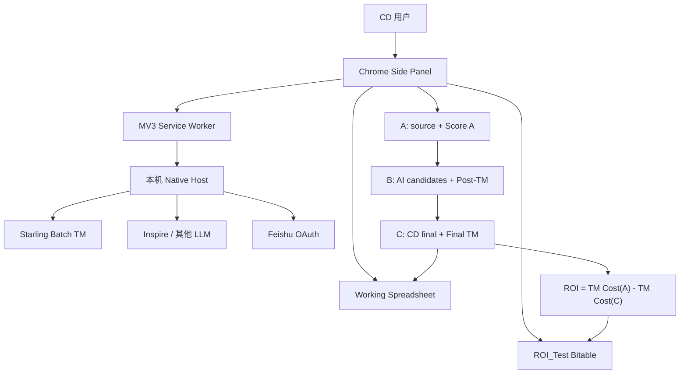

# L10n TM Companion 离职交接文档

> 本文是 L10n TM Companion 的接手入口，面向后续产品、Content Design、本地化、研发和公司 Agent。目标是让接手人在原负责人无法回复的情况下，能够判断当前真实状态、继续受控 Pilot、推进生产化，并避免回退已经确认的业务逻辑。

## 基本信息

| 字段 | 内容 |
|---|---|
| 交接项目 | L10n TM Companion |
| 交接范围 | 产品逻辑、客户端与 Native Host、TM/AI 审阅、Sheet 写回、多语言 ROI、安装分发、OAuth Broker 与异步 ROI Backend 方案 |
| 交接人 | `[待填写：姓名 / 团队 / 联系方式]` |
| 接手人 | `[待填写：姓名 / 团队 / 接手范围]` |
| 交接生效日期 | `[待填写]` |
| 文档版本 | V1.0 |
| 最后更新 | 2026-07-30 |
| 源码位置 | `/Users/bytedance/my-project/l10n-tm-companion` |
| 私有 Git 远端 | `https://github.com/TRUSOGEN/l10n-tm-companion.git` |

本文只覆盖该插件。团队例会、汇报节奏、群组、审批流程和具体人员关系没有足够证据，均以 `[待填写]` 标出，交接双方需要在离职前补齐。

## 接手人先做的三件事

1. **保护当前 `1.3.4` 工作区。** 当前分支是 `codex/publish-v1.3.3`，HEAD 为 `28293ac`，但工作区包含尚未提交的 `1.3.4` UI、分页、i18n、文档、Native Host 和测试修改，以及两份未跟踪的 Backend 规格。禁止 `git add .`、重置或用旧分支覆盖；先建立独立分支并逐文件确认归属。
2. **补齐真实 E2E 和 Owner 门禁。** 本地测试已经通过，真实 Inspire、Starling PPE、Feishu Sheet、ROI_Test、权限发布、schema migration 和多语言性能仍未形成完整生产证据。先用 2–3 条非生产 source 验证最小闭环，同时收齐本文“生产门禁”中的六项 Owner 答案。
3. **按阶段推进生产化。** 先实现 OAuth Broker，确保普通用户电脑不保存 Feishu App Secret；再实现持久 ROI Worker，以 shadow compute 对齐当前 A−C 金额，最后才开放 ROI_Test 写入、Pilot 和 Production。

## 项目定位与业务价值

L10n TM Companion 是面向 Content Design（CD）与本地化团队的 Chrome Side Panel 插件。它把英文 source 读取、Starling Top-3 TM 查询、受控 AI 改写、人工确认、Final TM、Working Sheet 写回和多语言 ROI 审计串成一个闭环，减少人工复制、工具切换和重复核对。

产品使用 human-in-the-loop：AI 只处理中间 TM 匹配区间，候选必须通过规则门禁和真实 Post-TM；CD 决定最终英文 C；Final TM 与 Sheet 写回成功后才算确认。ROI 保留覆盖、失败原因和 Operator，支持回答一整车文案节省了多少钱、哪些语言或 source 未完成、谁执行了归档。

当前适合受控 Pilot。生产规模化需要服务端 OAuth、应用身份 ROI 代写、持久异步任务、企业签名和真实性能数据。

## 当前真实状态

| 事项 | 状态 | 说明 |
|---|---|---|
| 客户端版本 | 本地 `1.3.4`，未形成干净 commit | `manifest.json` 已是 1.3.4；发布基线仍是 commit `28293ac` 的 1.3.3 |
| Top-3 TM、50–85 AI、审阅与确认 | 已实现并本地验证 | 真实生产集成 E2E 仍需补齐 |
| Working Sheet 六列写回 | 已实现并本地验证 | 需要真实飞书权限和空行/动态列布局 E2E |
| ROI Runs / Scopes / Items | 已实现客户端归档逻辑 | 真实 ROI_Test 三表 E2E、权限和失败恢复仍未完成最终确认 |
| Feishu OAuth | 当前 Pilot 可用本机 Keychain Secret | 普通用户正式分发方案未完成 |
| OAuth Broker | 规格与实现契约已完成 | `backend/` 尚未实现或部署 |
| 异步 ROI Worker | 规格与状态机已完成 | 尚未实现、shadow compute 或部署 |
| 安装分发 | 构建脚本和 ad-hoc Installer 已有 | 旧安装包/备份不作为源码依据；需要时从当前源码重新构建 |
| 企业分发 | 未完成 | 仍需 Developer ID、notarization 或 MDM |
| 性能 | 只有结构性优化和理论请求数 | 无可信的完整语言集合 P50/P95 生产数据 |

## 长期业务契约

### A、B、C 与正式 ROI

- **A** 是原始英文 source 及其真实 TM 成本。
- **B** 是 AI 候选及其真实 Post-TM，只用于审阅证据和 AI uplift 漏斗。
- **C** 是 CD 最终确认的英文文案及其真实 Final TM 成本。
- **正式 ROI** 永远是 `TM Cost(A) - TM Cost(C)`。B 不能替代 C 进入正式金额。
- 任一条目或语言失败时保留 `incomplete`；所有成功覆盖仍计入 subtotal，并记录缺口原因。
- 零条 confirmed 时拒绝归档，错误码为 `roi_archive_requires_confirmed_review`。

### AI 门禁与候选

- AI eligibility 使用半开区间 `50 ≤ Score A < 85`：49.99 跳过、50 进入、84.99 进入、85 跳过。
- 每条 eligible source 只创建一个 Inspire task，最多保留三个候选。
- 候选依次通过结构、placeholder/protected token、URL、数字、Glossary、Legal、语义和风险校验。
- 每个结构有效候选必须查询真实 Post-TM；只有安全且 `Score B > Score A` 的候选可选择。
- 分数下降、持平或被安全门禁拒绝的候选文本显示为 `None`，但保留可解释原因和已查询的分数/差值。

### 审阅、确认与 Sheet

- `Review & edit / 审阅与修改` 是唯一编辑入口，避免“详情”和“Focus”重复。
- 单条确认事务固定为：本地校验 → 真实 Final TM → 当前 Sheet 行六列写入 → `confirmed`。
- 修改已确认文案会变为 `dirty`，旧 Final TM 失效，必须重新确认。
- 输出连续六列：`Best TM Match`、`Orig Match %`、`Rewritten Segment`、`Post-TM %`、`Reached 85%?`、`Final TM %`。
- 旧 `CD review valid?` 数据区为空时允许迁移；存在人工值时以 `legacy_cd_review_data_conflict` 正确失败，禁止覆盖历史确认。

### Starling、项目和费率

- 项目列表来自当前 AK/SK 的 Starling `/projects`；失败或空列表不使用缓存/默认项目伪装成功。
- 一次选择 1–10 个项目；`projectIds` 和单次 Batch 的 `sourceContents` 均最多 10 条，所选项目 source locale 必须一致。
- Vendor 不授予项目权限，只用于 ROI 费率过滤。当前 Vendor 为 RWS、Pactera、Alconost、Skrivanek。
- 费率必须按 `vendor + source locale + target locale` 精确匹配。缺失、重复或只有 hourly rate 时正确失败，不跨 Vendor 借价、不填零价。
- 默认 TM 路径只做 Batch TM，不自动调用 `/project/search` 或 Key lookup。
- Starling 请求失败必须展示真实错误并停止，禁止使用本地 BM25 或伪造的 0 分当作真实 TM。

## 当前架构与数据流



当前版本没有 Backend。Side Panel 生命周期仍承载延后语言补算和 ROI 归档；本机 Native Host 从 Keychain 读取 App Secret 完成 OAuth token exchange。目标架构见 `docs/oauth-broker-async-roi.md`：Native Host 通过公司 HTTPS 网关访问 API，PostgreSQL 持久化 OAuth grant、run、item、job 和 archive snapshot，Worker 继续 Starling 计算与 ROI_Test 写入。

## 关键模块

| 路径 | 职责 |
|---|---|
| `popup.js` / `popup.html` / `popup.css` | Side Panel 主流程、项目/Sheet 配置、Review、Confirm、ROI 入口 |
| `background.js` | Service Worker 与 Native Messaging 路由 |
| `native-host/starling-bridge.py` | Starling、LLM 和当前本机 OAuth 桥接 |
| `native-host/feishu_oauth.py` | localhost callback、PKCE 和当前 token exchange |
| `native-host/starling-batch-client.js` | Starling Core 签名和 Batch TM |
| `lib/source-rewrite-policy.js` | AI 候选结构、安全和真实 Post-TM 门禁 |
| `lib/review-workflow.js` | draft / dirty / confirmed 状态机 |
| `lib/feishu-sheets.js` / `lib/sheet-layout.js` | Spreadsheet 识别、动态列布局和按真实行号写回 |
| `lib/roi-calculation.js` / `lib/multilingual-roi.js` | A−C 金额、coverage、subtotal 与 incomplete |
| `lib/roi-bitable-archive.js` | ROI_Test Runs / Scopes / Items schema 和归档 |
| `data/local-rates.json` | 冻结的本地费率目录，不等同于已签署的服务端 Vendor policy |
| `skills/cd-content-review-version-2/` | AI 候选使用的内容审阅规则快照 |
| `test/` | 业务契约、协议、UI 和 Native Host 回归测试 |

## 日常使用 SOP

### 配置与运行

1. 在 Settings 填写并验证 Starling AK/SK；配置 Inspire Access Key、Provider、Model；完成 Feishu 用户 OAuth。
2. 打开有权限的 Spreadsheet 或 Wiki 挂载表格；确认来源列、起始行和六列输出区域。
3. 选择 1–10 个同 source locale 的 Starling 项目；普通任务保持 ROI mode 关闭。
4. 点击 `Read source → Query TM → AI rewrite`，等待 Top-3 TM、eligible AI 和候选 Post-TM。
5. 在 `Review & edit` 中只修改例外项；单条确认或批量确认其余默认项。
6. 到 Sheet 核对原文列未被覆盖、六列与真实行号一致；错误时保留完整错误文字和 Request ID。

### ROI 运行

1. 运行前开启 ROI mode，选择 Vendor 和有精确费率的共享 target locales。
2. 至少确认一条 C；未确认条目会作为 coverage 缺口。
3. 点击 `Write ROI archive`，核对 `1 Run + N Scopes + M Items` 后确认。
4. 在 ROI_Test 核对 Operator、A/AI/Review 漏斗、金额、Scope 失败原因和 Item 数。
5. 当前客户端归档过程中不要关闭 Side Panel；未来异步 Worker 完成后该限制应删除。

### 构建与更新

```bash
./native-host/install.sh --dry-run --no-open
./native-host/install.sh --no-open
./scripts/build-offline-package.sh
for f in test/*.test.js; do node "$f"; done
```

安装后在 `chrome://extensions` 刷新扩展，并使用 `Command + Q` 完全退出 Chrome再重开。当前安装器只有 ad-hoc 签名；不得对外承诺无提示企业分发。

### 排障信息

要求用户提供 macOS/Chrome/插件版本、完整错误文字、HTTP 状态码、Request ID、所选项目/语言、脱敏后的 source 和出错步骤。不得要求用户发送 AK、SK、Access Key、App Secret 或 OAuth token。Native Host/安装问题可检查 `/tmp/l10n-bridge-debug.log` 与 `/tmp/l10n-tm-companion-installer.log`，分享前必须脱敏。

## 资产、权限和账号

| 资产或权限 | 用途 | 当前状态 | 交接动作 |
|---|---|---|---|
| 私有 GitHub 仓库 | 源码与发布历史 | origin/main 仍停留在早期交付；当前 1.3.4 未形成干净 commit | `[待填写 Owner]` 授权接手人；先保护 dirty tree |
| Starling AK/SK 与项目 ACL | 项目发现和 TM 查询 | 每个用户/服务身份独立授权 | 通过公司安全渠道申请，禁止写入本文 |
| Inspire Access Key / Team / Model | AI 改写 | Pilot 使用个人 Access Key；真实容量受 Owner 控制 | `[待填写 Inspire Owner]` 确认可用模型、额度和生产代理 |
| Feishu 应用 | 用户 OAuth、Sheet、Bitable 和 Operator | scopes、发布版本和 refresh 能力需 Owner 最终确认 | `[待填写 Feishu App Owner]` 转移应用管理权限 |
| Feishu App Secret | 当前本机 token exchange | Pilot Owner 可存 Keychain；正式用户不可持有 | 转入公司 Secret Manager，不得明文交接 |
| ROI_Test | 固定 ROI 审计目标 | direct_user 写入要求用户本人有编辑权 | `[待填写 ROI Owner]` 转移管理权并确认应用身份编辑权限 |
| local rate 原始表 | 生成 `data/local-rates.json` | RWS/Pactera 有按字费率；其他 Vendor 可能 hourly-only | `[待填写 Localization/Finance Owner]` 确认来源、更新周期和生效日期 |
| Apple Developer / MDM | 企业安装 | 尚未接入 | `[待填写 IT/Release Owner]` 评估 Developer ID、notarization 或 MDM |
| 公司服务平台 / KMS | OAuth Broker 与 Worker | 未确认 | `[待填写 Infra/Security Owner]` 确认模板、网关身份、Secret Manager、KMS 和数据政策 |

所有权限必须通过公司批准的账号和 Secret 管理流程移交。本文不得补录任何真实密钥、token、员工个人 ID 或密码。

## 协作与决策地图

| 角色 | 负责决策 | 主要卡点 | 对接人 |
|---|---|---|---|
| Product / CD Owner | 用户路径、50–85 门禁、Review、Pilot 范围、验收 | 避免增加重复入口和非必要配置 | `[待填写]` |
| Starling Owner | 服务身份、项目 ACL、PPE/Production endpoint、QPS、并发、重试 | 用户项目权限与 Feishu 权限无关 | `[待填写]` |
| Inspire Owner | 模型、Access Key、Team、吞吐和生产代理 | 客户端额度不能当作生产容量 | `[待填写]` |
| Feishu App Owner | OAuth scopes、redirect、发布、refresh、tenant token | 发布新 scope 后用户必须重新授权 | `[待填写]` |
| ROI_Test Owner | Bitable schema、视图、权限和容量 | direct_user 与应用身份写入边界 | `[待填写]` |
| Localization / Finance | locale→vendor→rate policy 和生效日期 | 禁止从会议口径直接推导生产规则 | `[待填写]` |
| Security / Infra | 网关身份、Secret Manager、KMS、保留与删除政策 | 生产开关的硬门禁 | `[待填写]` |
| IT / Release | Developer ID、notarization、MDM | 当前安装器仅适合受控 Pilot | `[待填写]` |

固定会议、周报、评审和发布窗口：`[待填写；当前材料中无可靠记录]`。

## 进行中的工作

| 优先级 | 工作 | 当前状态 | 下一步 | 完成证据 |
|---|---|---|---|---|
| P0 | 保护并整理 1.3.4 | dirty tree，未提交 | 建独立分支，逐文件 review，运行全量测试，形成可审计 commit | commit、diff、测试结果、版本一致 |
| P0 | Feishu 最小真实 E2E | 本地逻辑完成，真实三表闭环未最终确认 | 发布正确 scopes，重新授权；用 2–3 条非生产 source 验证 Confirm、Final TM、六列和 ROI 三表 | 飞书记录、Operator、金额、错误/Request ID |
| P0 | OAuth Broker Phase A | 设计与契约完成，代码/部署未开始 | 建 `backend/`、migration、session/exchange/refresh/revoke，生产构建移除本机 Secret | 无 Secret 新 Mac E2E、并发 refresh、revoke、安全失败 |
| P1 | 异步 ROI Worker Phase B | 设计与契约完成，未实现 | 先关闭 ROI_Test 写入做 3/18 条 shadow parity，再做 100 条故障/负载测试 | 逐 item/locale A−C 一致、持久恢复、幂等归档 |
| P1 | 企业级分发 | 未完成 | Developer ID/notarization 或 MDM；明确 Chrome 加载策略 | 企业设备真实安装与升级证据 |
| P1 | 生产性能 | 未测 | 由 Starling Owner 批准负载参数，记录完整语言集合阶段耗时、P50/P95、请求数和失败率 | PPE/Production 监控与测试报告 |

## OAuth Broker 与异步 ROI 的生产门禁

缺少以下任一项时，可以开发和部署关闭 feature flag 的服务，不得启用生产流量：

- 公司服务平台、HTTPS 域名、Native Host 身份验证方式、Secret Manager 和 KMS。
- Feishu Owner 对 `offline_access`、refresh 设置、新应用版本和 Broker 访问的确认。
- Starling 服务端身份、PPE/Production endpoint、QPS、并发与重试契约。
- Localization/Finance 签署的 `locale → vendor → rate` policy。
- ROI_Test 的应用身份编辑权限、PPE 目标和固定 schema。
- source A/C、Sheet 标识、日志和备份的数据保留与删除政策。

阶段 A 必须先于阶段 B。阶段 B 先 shadow compute，禁止直接写生产 ROI_Test；差异清零或有书面解释后才能开放 PPE 写入。最终切换顺序是 OAuth Broker → async ROI → ROI archive write。

## 已验证与未验证边界

2026-07-30 在当前项目本体重新验证：

- 39/39 个 JavaScript 测试脚本通过。
- 六个独立 Python 测试脚本通过；`test_export_local_rates.py` 的四个 unittest case 通过。
- `git diff --check` 通过。
- `native-host/` 与 `scripts/` Python compileall 通过。

这些证据证明本地业务逻辑和协议回归通过，不证明真实生产链路已经可用。以下仍未形成完整证据：

- 真实 Inspire、Starling PPE、Feishu OAuth/Sheet、ROI_Test 三表和 live schema migration 的端到端结果。
- Feishu 新 scopes 已发布且 Pilot 用户重新授权。
- OAuth Broker、应用身份 ROI 代写、Backend、PostgreSQL Worker、PPE 和 Production 部署。
- Developer ID/notarization/MDM。
- 完整语言集合的真实 P50/P95、上游限流和故障恢复。

测试输出保存在 `temp/handoff-verification-20260730/`，只用于本机核对，不应进入正式发布包或 Git。

## 高风险、待决策和历史遗留

- **Git 风险：** 当前 1.3.4 只存在于 dirty tree。重置、广泛暂存或从旧远端覆盖会直接丢失产品工作。
- **OAuth 风险：** 当前 Keychain App Secret 只适合受控 Owner Pilot。正式多人分发必须完成 Broker，且 `refresh_uncertain` 时要求重新授权。
- **ROI 权限风险：** direct_user 写入要求用户本人拥有 ROI_Test 编辑权；“能提交但不能查看”必须使用应用身份代理。
- **归档一致性风险：** 当前客户端三表写入没有跨表事务和完整自动 repair；Backend 契约已定义 Run ID 防重、record ID 续写和 archive snapshot。
- **费率风险：** `local-rates.json` 是冻结输入，不是已签署的 Vendor policy。缺失或 hourly-only 费率必须保持不可计算。
- **性能风险：** 18 条 ×约 56 locale 的请求数优化只是理论推导，不是 benchmark；禁止承诺生产时延。
- **安装风险：** ad-hoc 签名和 Chrome 未打包扩展确认会产生用户摩擦，企业分发方案未完成。
- **文档漂移：** 历史 handoff、计划和旧报告可能仍写 1.3.3、旧列布局或已失效安装包路径。以本文、README、正式 Backend/ROI/Popup 契约和当前代码为准。

## 已确认的产品取舍

- 普通 TM 默认走快速路径，ROI 默认关闭；用户显式需要整车节省时才开启 ROI。
- Review 只保留一个入口，CD 主要修改例外项，其余可批量确认。
- Best TM Match 展示英文 `tm_source`；目标翻译只在真正复用翻译时使用 `tm_match`。
- 正式 ROI 使用 A−C；A−B 只能用于明确命名的 AI optimization 分析。
- `incomplete` 是覆盖警告，不抹掉有效 subtotal。
- 项目权限来自 Starling AK/SK ACL；Vendor 和 Feishu 权限不授予 Starling 项目。
- 默认 TM 流程不恢复 Key lookup、本地 BM25 或静默 fallback。
- Backend 最小架构使用 API + Worker + PostgreSQL；公司已有标准队列时可以替换领取实现，但不得改变状态机、事务和幂等契约。

## 文档与信息优先级

接手时按以下顺序判断事实，后者不得覆盖前者：

1. 本离职交接文档与当前代码/测试。
2. `README.md`：当前产品和快速 CLI 入口。
3. `docs/oauth-broker-async-roi.md` 与 `docs/oauth-broker-async-roi-contract.md`：Backend 目标架构和实现契约。
4. `docs/multilingual-roi.md`：正式金额、coverage 和 subtotal。
5. `docs/popup-configuration.md`：Side Panel 交互和运行配置。
6. `docs/user-guide.md`、`docs/offline-install-manual.md`、`docs/E2E-CHECKLIST.md`：用户使用、安装和真实验收。
7. `handoff/` 中其他 dated 文档：只用于追溯历史决策，不作为当前版本唯一事实。

## 接手 Checklist

### 离职前由交接双方完成

- [ ] 补齐交接人、接手人、生效日期和全部角色联系人。
- [ ] 接手人获得私有仓库访问权，并创建保护当前 1.3.4 的独立分支。
- [ ] Feishu 应用、ROI_Test、Starling、Inspire、费率源表和发布权限完成移交。
- [ ] 使用公司 Secret 管理方式转移必要凭证；文档和聊天中没有明文 Secret。
- [ ] 接手人独立执行一次 2–3 条 source 的 TM → Review → Confirm → Sheet 流程。
- [ ] 接手人能解释 A/B/C、50–85、六列、incomplete/subtotal 和项目权限来源。
- [ ] 六项 Backend 生产门禁分别确定 Owner、完成状态和预计时间。
- [ ] 团队群、固定会议、周报、评审和审批流程完成补充与拉群。

### 接手后第一周

- [ ] 冻结并审阅当前 dirty tree，形成可追溯的 1.3.4 commit 或书面拆分方案。
- [ ] 重跑 39 个 JavaScript 和七组 Python 验证，并检查输出内容。
- [ ] 完成真实 Feishu 最小 E2E，记录成功证据与所有阻塞。
- [ ] 评审 OAuth Broker API、数据库实体、feature flags 和公司部署依赖。
- [ ] 明确 Phase A 负责人、里程碑、PPE 地址和回滚方案。

## Suggested skills

- `codebase-design`：冻结 Backend 模块、状态机、事务、API 与数据流。
- `tdd`：从 OAuth rotation、幂等键、对象授权和 A−C parity 开始。
- `systematic-debugging`：处理 Starling、Feishu、Native Messaging、队列和故障注入。
- `verification-before-completion`：区分本地测试、PPE、Pilot 和 Production 证据。
- `git-guardrails-Codex`：保护 dirty tree，禁止危险 Git 操作和广泛暂存。
- `handoff`：每个阶段结束后在本项目 `handoff/` 目录记录 commit、环境、地址、权限、验证和未完成边界。
